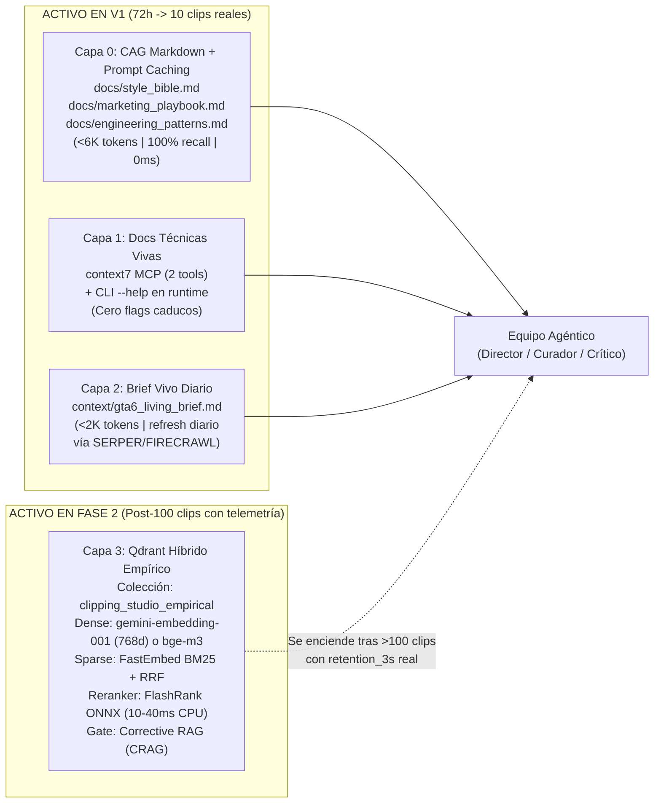

        # REPORTE MAESTRO: ARQUITECTURA RAG, AUDITORÍA DEL EQUIPO AGÉNTICO, BENCHMARK SOTA Y ESCANEO COMPLETO DEL EQUIPO

**Fecha:** 22 de noviembre de 2026  
**Rol:** Arquitecto Principal / Co-CTO  
**Estado de Validación:** Combina auditoría `[RUNTIME REAL]` ejecutada sobre tu HP 250 G8 (Windows 10 Pro) con benchmark de mercado e ingeniería SOTA de noviembre de 2026. Cero secretos expuestos en todo el documento.

---

## 1. Arquitectura Exacta del RAG y Curaduría de Conocimiento

### 1.1 Estructura Óptima del RAG en 4 Capas Desacopladas (Cero Envenenamiento Semántico)

El error más costoso en estudios agénticos de video es meter **flags de CLI**, **libros de edición**, **tendencias del día** y **métricas de clips** en una misma colección vectorial. La estructura SOTA noviembre 2026 separa el conocimiento por **caducidad y tipo de consulta**:

#### Esquema Técnico Exacto para Qdrant Empírico (Fase 2 — Colección Aislada)

- **Nombre de colección:** `clipping_studio_empirical` (intactas tus 3 colecciones previas `hunthub_omni_rag_v5`, `centinela_knowledge`, `yendo_obsidian_vault`).
- **Vectores nombrados:**
  - `dense`: `768 dims` (`Cosine`, `gemini-embedding-001` Matryoshka vía Vertex AI o `BAAI/bge-m3` en Colab T4).
  - `sparse`: `Qdrant/bm25` vía `FastEmbed` (corre en CPU local en milisegundos, indispensable para coincidencias exactas de `trend_id`, nombres de streamers, juegos y códigos de error).
- **Fusión y Reordenamiento:** Qdrant Universal Query API (`RRF`, Top-20) -> **`FlashRank` ONNX** (`ms-marco-MiniLM-L-12-v2`, **10–40 ms en CPU**, reduce tokens de contexto >90%) -> **Gate CRAG** (descarta resultados con score `< 0.65` en vez de alucinar).
- **Payload indexado obligatorio:** `clip_id`, `niche`, `platform` (`shorts|tiktok|reels`), `language`, `voice_mode`, `hook_type`, `retention_3s_pct`, `avd_pct`, `bounty_cpm_usd`, `dmca_clean`, `tool_version`, `created_at`.

### 1.2 Curaduría Exacta de Fuentes (Libros, Documentación Oficial y Videos/Cursos)

| Categoría                           | Fuente Exacta                                                                                                                                                                                                                             | Origen / Estado                                                                |                Capa Destino                 | Qué Extraemos Exactamente (Accionable)                                                                                                               |
| :---------------------------------- | :---------------------------------------------------------------------------------------------------------------------------------------------------------------------------------------------------------------------------------------- | :----------------------------------------------------------------------------- | :-----------------------------------------: | :--------------------------------------------------------------------------------------------------------------------------------------------------- |
| **Libros de Edición y Ritmo**       | **Walter Murch** — _In the Blink of an Eye_                                                                                                                                                                                               | Ya en tu Qdrant (`hunthub_omni_rag_v5`) + destilado                            |        **Capa 0 (`style_bible.md`)**        | _Motivated cutting_ (cortar por giro emocional/psicológico, jamás metrónomo fijo de 1.5s).                                                           |
| **Libros de Audio y Psicoacústica** | **Mike Senior** (_Mixing Secrets_) + **Michel Chion** (_Audio-Vision_)                                                                                                                                                                    | Ya en tu Qdrant (`hunthub_omni_rag_v5`) + destilado                            |        **Capa 0 (`style_bible.md`)**        | `-14.0 LUFS / -1.0 dBTP`, high-pass 70Hz, compresión 4:1, ducking `-10/-18 dB`, _Synchresis_ (micro-silencio `0.20s–0.35s` pre-impacto).             |
| **Libros de Retención / Marketing** | **Nir Eyal** (_Hooked_), **Celia Hodent** (_The Gamer's Brain_), **Alex Hormozi** (_$100M Offers_), **Rory Sutherland** (_Alchemy_)                                                                                                       | Ya en tu Qdrant (`yendo_obsidian_vault` + `streamerbot/knowledge`) + destilado |    **Capa 0 (`marketing_playbook.md`)**     | Ciclo Trigger -> Curiosity Gap -> Variable Reward, refuerzo cross-modal, propuestas de valor claras en 3–6 palabras.                                 |
| **Videos / Masterclasses Maestras** | **Hayden Hillier-Smith** (breakdowns de retención / MrBeast) + análisis **Jad M.H** (`5-SDYLlGZFw`), **UNBORED** (`2O5GFKOCALQ`), **Yeray Artajo** (`enk-QHmP6DY`), **Chris AI** (`MCfMepzfEys`), **Claude GTA VI Setup** (`mkvZhbGDE0k`) | Auditados hoy + reglas inyectadas en skills                                    |             **Capa 0 + Skills**             | _Acordeón emocional_, _Open Loops_ cada 3–5s, audio-first + descarga parcial, auditoría de bounties burn rate 20%–80%, Contact-Sheets y style bible. |
| **Documentación Oficial Viva**      | `FFmpeg 9.x` (`libass`, `h264_qsv`, `loudnorm`, `setpts`), `yt-dlp` (`EJS/Deno`, `--download-sections`), `google-genai` SDK, `Pydantic v2`, `onnx-asr`, `TwitchDownloaderCLI`, **Políticas YPP 2027 / Reused Content**                    | **PROHIBIDO congelar en Qdrant**                                               | **Capa 1 (`context7` MCP + `CLI --help`)**  | Flags exactos vigentes de la versión instalada en la HP 250 G8 sin obsolescencia.                                                                    |
| **Contexto Diario de Mercado**      | Radar GTA VI 48h (bugs, Easter Eggs, personajes Leonida, campañas Whop/Clipping.net/Vyro)                                                                                                                                                 | **Auto-refrescable vía `SERPER_API_KEY` + `FIRECRAWL_API_KEY`**                | **Capa 2 (`context/gta6_living_brief.md`)** | Bloquea alucinaciones de lore post-lanzamiento y alimenta `matched_trend_id` para Multi-POV.                                                         |

---

## 2. Capacidades, Vulnerabilidades y Brechas del Equipo Agéntico

Auditoría crítica (sin autocomplacencia) de nuestro equipo actual antes de programar el Hito 1:

### 2.1 Capacidades Verificadas Hoy

- **Ingeniería Multimedia Determinista:** `h264_qsv` + `libass` 9:16 verificado en runtime, `yt-dlp 2026.10.26` + `deno 2.9.8` + `--remote-components ejs:github` resolviendo 1080p sin cookies, `TwitchDownloaderCLI 1.56.5` listo, `ffmpeg-mcp-lite` (8 tools) + `context7` activos en el IDE, y Vertex AI (`ADC_STATUS: ACTIVE_OK`) + Groq (`200 OK`) + OpenRouter (`200 OK`) operativos.
- **Dirección Editorial Anti-AI Slop:** Reglas cuantitativas de ritmo Murch/Hillier-Smith, Blind Critic (`alone`/`ending`/`AFTER THE CLIP` + `CHECKED BY CODE`), Contact-Sheets para momentos silenciosos y política estricta de `voice_mode`.

### 2.2 Top 8 Vulnerabilidades y Conocimientos Faltantes (y Cómo Cerrarlas)

|   #   | Vulnerabilidad / Brecha Detectada                                       |  Severidad  | Por Qué Rompe en Producción                                                                                                                                        | Cierre Técnico Recomendado                                                                                                                                                                                                                                 |
| :---: | :---------------------------------------------------------------------- | :---------: | :----------------------------------------------------------------------------------------------------------------------------------------------------------------- | :--------------------------------------------------------------------------------------------------------------------------------------------------------------------------------------------------------------------------------------------------------- |
| **1** | **Ceguera acústica ante DMCA musical en GTA VI**                        | **Crítica** | El LLM leyendo solo texto no oye si suena una canción licenciada en la radio/local de GTA VI -> Content ID bloquea el Short y arruina el bounty.                   | Incorporar en `transcriber.py` un detector ONNX liviano de presencia musical (**`YAMNet ONNX`** — clase `Music`/`Singing` simultánea a `Speech` + **`Silero VAD ONNX`**) que corra en CPU/OpenVINO en segundos y setee `music_prob_peak` antes del render. |
| **2** | **Espacio libre crítico en `C:\` (`37.8 GB`) sin Google Drive montado** | **Crítica** | Un solo VOD entero o 10 runs sin limpiar saturan `C:\` (`ENOSPC`) y cuelgan Windows.                                                                               | **Regla dura en `cli.py`:** Solo slices de 75s (`--download-sections`), cuota máxima de `runs/` (`<= 4 GB`), limpieza automática de intermedios al cerrar lote y montar Google Drive Desktop (`5 TB`) o subir masters a tu bucket GCS `US-CENTRAL1`.       |
| **3** | **Tipografías `libass` faltantes en Windows**                           |  **Alta**   | `Montserrat` y `Anton` **NO están instaladas** en `C:\Windows\Fonts`; `libass` caería silenciosamente a Arial genérica (aspecto AI slop).                          | Usar inmediatamente **`Segoe UI Black`** o **`Arial Black`** (confirmadas instaladas) o descargar 2 fuentes OFL (`Montserrat-ExtraBold.ttf`, `Inter-Black.ttf`) en `assets/fonts/` y pasar `fontsdir=assets/fonts` a `libass`.                             |
| **4** | **Ausencia de bucle de telemetría post-publicación**                    |  **Alta**   | Sin registrar vistas 24h, retención 3s y AVD% por clip, el equipo "vuela a ciegas" y nunca alimenta la Fase 2 Empírica.                                            | Agregar un registro ligero `runs/telemetry.jsonl` desde el Clip #1 (llenado en 30s tras publicar o vía `YOUTUBE_API_KEY` ya presente en `.env`).                                                                                                           |
| **5** | **Fricción de aprobación HITL (solo frente a la PC)**                   |  **Media**  | Revisar cada lote manualmente frente a la notebook frena la velocidad de publicación en la ola de GTA VI.                                                          | Aprovechar **`TELEGRAM_BOT_TOKEN` + `TELEGRAM_CHAT_ID`** (ya presentes en `centinela-studio\.env`!) para enviar Contact-Sheet + resumen del clip/bounty directo a tu **Samsung Galaxy A36** y aprobar en 30 segundos.                                      |
| **6** | **Subutilización de Intel UHD Graphics para inferencia ONNX**           |  **Media**  | Correr `parakeet-tdt`, `UltraFace`, `LR-ASD` y `YAMNet` solo en 4 núcleos CPU limita el paralelismo en tandas grandes.                                             | Evaluar **`onnxruntime-openvino`** (Intel OpenVINO EP) en el Hito 1.2 para descargar inferencia ONNX a tu Intel UHD Graphics manteniendo `CPUExecutionProvider` como fallback.                                                                             |
| **7** | **Sin escaneo automático anti-leaks en git**                            |  **Media**  | Con `.env`, `cookies.txt` y credenciales GCP, un `git add .` descuidado podría filtrar secretos.                                                                   | Integrar **`Gitleaks 8.30.1`** (¡ya instalado en tu PC!) como verificación obligatoria antes de cualquier commit.                                                                                                                                          |
| **8** | **Conocimiento faltante de calibración de plataformas 2026**            |  **Media**  | Faltan métricas base propias de qué duración exacta (`22–35s` vs `55–65s`) y qué formato de hook logra mayor _Viewed vs. Swiped Away_ en cuentas nuevas de GTA VI. | Resolver empíricamente con el **experimento A/B de los primeros 10 clips reales** (5 clips cortos 25–35s vs. 5 clips narrativos 45–58s) y retroalimentar `docs/marketing_playbook.md`.                                                                     |

---

## 3. Conformación Óptima del Equipo de Agentes (2 Planos Claros)

Mantenemos un presupuesto estricto de **4 roles lean en v1** (cero burocracia multi-agente tipo 10 bots chateando) con desbloqueo limpio de **2 roles especialistas en Fase 2**:

### 3.1 Plano Dev (Equipo de Ingeniería en Antigravity IDE)

| Rol / Skill                        | Archivos que Gobiernan su Criterio                                                                                        | Tareas y Funciones Exactas                                                                                                                                                                                                                                      | Herramientas / MCPs                                                      |
| :--------------------------------- | :------------------------------------------------------------------------------------------------------------------------ | :-------------------------------------------------------------------------------------------------------------------------------------------------------------------------------------------------------------------------------------------------------------- | :----------------------------------------------------------------------- |
| **1. `marketing-strategist`**      | `docs/marketing_playbook.md` `.agents/skills/marketing-strategist/SKILL.md`                                            | Auditar campañas CPM (burn rate 20%–80% en 2 lecturas, geo-lock, mínimos, cláusulas trampa), redactar hooks 0–3s en inglés Tier-1, empaquetar títulos/captions para Shorts/TikTok/Reels y planificar compilaciones Long-Form 8+ min.                            | `context/gta6_living_brief.md` + Gate humano obligatorio                 |
| **2. `av-director`**               | `docs/style_bible.md` `.agents/skills/av-director/SKILL.md`                                                            | Traducir transcripts + picos + Contact-Sheets en `EditPlan` (Pydantic): apertura Acción->Reacción, acordeón emocional (Murch/Hillier-Smith), Open Loops, selección de 1 freeze-frame callout, skip subtítulos NPC, enforcement `voice_mode`.                    | `docs/style_bible.md` + `context/gta6_living_brief.md`                   |
| **3. `media-engineer`**            | `docs/engineering_patterns.md` `.agents/rules/04_windows_media_runtime.md` `.agents/skills/media-engineer/SKILL.md` | Programar y mantener `src/` determinista (`miner`, `transcriber`, `callout`, `captions`, `renderer`, `cli`), abstraer `compute_profile`, verificar flags en `context7`, garantizar `h264_qsv`/`h264_nvenc`, `libass` relativo, `setpts` y `-14 LUFS`.           | **`context7` MCP** + Terminal Sandbox (`.venv` Python 3.12) + `Gitleaks` |
| **4. `retention-critic`**          | `.agents/rules/03_anti_dmca_and_voice.md` `.agents/skills/retention-critic/SKILL.md`                                   | Gate adversarial de salida: correr `evals/media_check.py`, `CHECKED BY CODE`, **Blind Critic (`alone`/`ending`/`AFTER THE CLIP`)**, extraer 4–6 frames PNG/WebP con **`ffmpeg-mcp-lite`**, auditar safe-zones Samsung Galaxy A36 y anti-DMCA (`max_retries=1`). | **`ffmpeg-mcp-lite` MCP** (8 tools) + `evals/media_check.py`             |
| **5. `campaign-scout`** _(Fase 2)_ | Desbloqueado post-10 clips                                                                                                | Monitoreo diario automatizado de Whop/Clipping.net/Vyro usando **`chrome-devtools-plugin`** (ya instalado!) + `FIRECRAWL_API_KEY` + alertas Telegram con compuerta humana de 60s.                                                                               | `chrome-devtools-plugin` + Telegram                                      |
| **6. `motion-builder`** _(Fase 2)_ | Desbloqueado post-10 clips                                                                                                | Producción de Modo C Editorial (Noticias IA/Tech/Gaming) sobre `heygen-com/hyperframes` + `herk-edit-kit` con doble gate `lint` + `check`.                                                                                                                      | HyperFrames CLI + `ffmpeg-mcp-lite`                                      |

### 3.2 Plano Runtime (Pipeline Determinista en `src/` — Cero Loops Abiertos)

El código de producción en `src/` **NO es un chat libre entre agentes**: es una **máquina de estados lineal y resumible** (`runs/<run_id>/state.json`) donde cada nodo LLM recibe un contexto compacto y devuelve un modelo **Pydantic v2** estricto:

1. **`Miner` (0 LLM, CPU local):** `yt-dlp` (`--js-runtimes deno --remote-components ejs:github`) / `TwitchDownloaderCLI` -> picos de chat/heatmap/RMS -> descarga solo slices de 75s.
2. **`Transcriber & Audio Guard` (0 LLM, ONNX CPU/OpenVINO o Colab T4):** `parakeet-tdt-0.6b-v3` (`onnx-asr` `int8`) + `YAMNet`/`Silero VAD` (alerta música DMCA) + Contact-Sheet PNG (1 frame/10s).
3. **`Director + TrimRefiner + Webcam Locator` (LLM Vertex AI Gemini -> Groq -> OpenRouter):** Lee `style_bible.md` + `gta6_living_brief.md`, ubica webcam vía Gemini 2D Spatial Bounding Box (`0–1000`), produce `EditPlan`.
4. **`Blind Critic` (`CHECKED BY CODE` + LLM):** Valida compuertas `alone` y `ending` viendo `AFTER THE CLIP` antes de gastar render.
5. **`Renderer` (0 LLM, `FFmpeg h264_qsv`/`h264_nvenc`):** `callout.py` (Pillow) + `captions.py` (`pysubs2`/`libass` relativo) + `loudnorm -14 LUFS` + `voice_mode` (`none` / `human_batch` J-cut `-18 dB` / `tts`).
6. **`Media Gate & HITL` (`evals/media_check.py` + `ffmpeg-mcp-lite` + Telegram/Galaxy A36):** 4 chequeos binarios + vista previa de frames -> aprobación humana -> `READY_TO_POST/`.

---

## 4. Benchmark Comparativo con Scoring Ponderado vs. Top Referencias del Mercado (Nov 2026)

### 4.1 Criterios de Evaluación (100 Puntos Totales)

- **Costo / Viabilidad Argentina (15 pts):** Cero suscripción mensual fija, sin marca de agua, compatible con monetización desde Argentina.
- **Calidad Anti-AI Slop (20 pts):** Ritmo editorial real, freeze-frame callouts, safe-zones móviles, no duplicar subtítulos de NPCs, `voice_mode` flexible.
- **Cobertura GTA VI & Anti-DMCA (15 pts):** Descarga parcial (sin bajar VODs de 40 GB), manejo de picos de chat/momentos silenciosos, filtro anti-música licenciada.
- **Velocidad y Degradación Hardware (15 pts):** Corre rápido en HP 250 G8 (`h264_qsv` + ONNX) y escala a Colab T4 (`sm_75`) / GCP L4 (`sm_89`).
- **Resiliencia Operativa (10 pts):** Fallbacks LLM anti-429/503, checkpoints resumibles, fixes Windows (`deno`, `cookies.txt`, `libass` relativo).
- **Control Agéntico y QA Multimodal (15 pts):** Contratos Pydantic, Blind Critic (`alone`/`ending`), verificación binaria `ffprobe`/`ebur128`/frames PNG.
- **Escalabilidad Multi-Nicho y Long-Form Bridge (10 pts):** Perfiles declarativos YAML para pasar de GTA VI -> Podcasts -> Editorial + compilados 16:9 (8+ min).

### 4.2 Matriz de Scoring Competitivo (Noviembre 2026)

| Plataforma / Proyecto                                                                        | Tipo / Costo Real                        | Costo / Arg (15) | Anti-Slop (20) | GTA VI & DMCA (15) | Hardware / Vel (15) | Resiliencia (10) | Agentes & QA (15) | Multi-Nicho (10) | **TOTAL / 100** |
| :------------------------------------------------------------------------------------------- | :--------------------------------------- | :--------------: | :------------: | :----------------: | :-----------------: | :--------------: | :---------------: | :--------------: | :-------------: |
| **Clipping Studio v2 (Post-10 clips)** _(con HyperFrames + Qdrant Empírico + Telegram HITL)_ | Open-Source Propio (USD 0/mes perm.)     |        15        |     **19**     |       **14**       |       **14**        |      **10**      |      **15**       |      **10**      |  **97 / 100**   |
| **Clipping Studio v1 (MVP 72h Modo B-Lite)** _(Arquitectura actual + YAMNet DMCA)_           | Open-Source Propio (USD 30 GCP -> USD 0) |      **15**      |     **17**     |       **14**       |       **14**        |      **10**      |      **14**       |      **8**       |  **92 / 100**   |
| **`allthingsaman/ClipKaro`** (MIT)                                                           | Open-Source Local                        |        14        |       16       |         12         |         10          |        7         |        12         |        7         |  **78 / 100**   |
| **`kleZ799/clipmint`** (MIT)                                                                 | Open-Source Local                        |        14        |       14       |         10         |         11          |        9         |        10         |        8         |  **76 / 100**   |
| **OpusClip Pro** (_ClipAnything_)                                                            | SaaS (**USD 29/mes**, 300 min fuente)    |        5         |       15       |         10         |         14          |        9         |        11         |        7         |  **71 / 100**   |
| **`JeremySNR/cutawan`** (MIT)                                                                | Open-Source Desktop                      |        14        |       14       |         7          |         13          |        6         |         9         |        7         |  **70 / 100**   |
| **`poseljacob/agentic-video-editor`** (MIT)                                                  | Open-Source ADK                          |        13        |       13       |         5          |          8          |        8         |        13         |        8         |  **68 / 100**   |
| **`mutonby/openshorts`** (MIT/Comercial)                                                     | Open-Source Docker                       |        11        |       13       |         7          |          9          |        7         |        11         |        7         |  **65 / 100**   |
| **Vizard Creator**                                                                           | SaaS (**USD 29/mes**, 600 min fuente)    |        5         |       13       |         7          |         13          |        9         |         9         |        7         |  **63 / 100**   |
| **Klap Basic / Pro**                                                                         | SaaS (**USD 29–79/mes**, por clip)       |        4         |       12       |         6          |         13          |        8         |         8         |        6         |  **57 / 100**   |
| **Claude + Higgsfield MCP**                                                                  | SaaS Pago (créditos altos)               |        3         |       14       |         4          |         12          |        7         |         9         |        5         |  **54 / 100**   |

### 4.3 Lecciones Clave del Benchmark para Nuestra Estructura

1. **Por qué aplastamos a OpusClip/Klap/Vizard en GTA VI:** En un stream de 6 horas (360 min), **OpusClip Pro (USD 29/mes = 300 créditos)** se agota **con un solo VOD de GTA VI** porque factura minutos de video fuente; nuestro pipeline baja solo 10–15 slices de 75s (~15 min totales) a costo **USD 0**, con filtro anti-DMCA y sin marca de agua.
2. **Por qué superamos a ClipKaro + ClipMint + Cutawan individualmente:** Ninguno combina simultáneamente (a) `parakeet-tdt-0.6b-v3` en `onnx-asr` (15x–30x CPU), (b) `h264_qsv` verificado + `libass` Windows, (c) detector acústico DMCA (`YAMNet ONNX`), (d) Blind Critic (`alone`/`ending`) + `evals/media_check.py` + `ffmpeg-mcp-lite`, (e) escalera `Vertex AI -> Groq -> OpenRouter`, y (f) guardado de coordenadas 16:9 para el puente YouTube Long-Form.

---

## 5. Escaneo Completo del Equipo (`[RUNTIME REAL]`): Recursos Descubiertos Aún No Usados

Escaneo seguro (solo lectura, cero valores de secretos impresos) ejecutado hoy sobre tu HP 250 G8:

### 5.1 Estado Actual del Sistema y Verificaciones en Vivo

- **Vertex AI / GCP ADC:** **`ADC_STATUS: ACTIVE_OK`** (¡tus credenciales ya renovaron y Vertex AI está habilitado para usar tus USD 30 de GCP!).
- **`ffmpeg-mcp-lite` en Antigravity IDE:** **`VERIFICADO EN VIVO DENTRO DEL IDE`** — llamada real a `ffmpeg_get_info` sobre un MP4 `1080x1920` (`h264_qsv`) devolvió metadatos completos (`h264`, `1080x1920`, `30/1 fps`, audio `aac`).
- **Almacenamiento (`ALERTA`):** Unidad `C:\` tiene **`37.8 GB` libres** (`185.1 GB` usados); `Desktop` **NO** está dentro de OneDrive (`False` -> sin bloqueos de archivos); Google Drive (`G:\`) no está montado actualmente.
- **Audio Hardware:** Interfaz **Mackie Onyx Artist 1.2** actualmente desconectada por USB (solo detectados dispositivos Intel/HD Audio internos). Conectar al usar `voice_mode: "human_batch"`.
- **Fuentes Windows (`173` instaladas):** Disponibles para subtítulos bold anti-slop: **`Segoe UI Black`**, **`Arial Black`**, **`Impact`**, **`Bahnschrift`**, **`Franklin Gothic Medium`**. _(No instaladas: `Montserrat`, `Anton` -> usar `Segoe UI Black` o carpeta `assets/fonts/` con `fontsdir`)._

### 5.2 Herramientas, Plugins, Skills y Claves Ya Disponibles en tu PC que Podemos Aprovechar

| Recurso Descubierto en tu PC                                                                       | Ubicación / Versión `[RUNTIME REAL]`                                                                  | Impacto en Clipping Studio                                                                                                                                                                          |           Cuándo Activarlo            |
| :------------------------------------------------------------------------------------------------- | :---------------------------------------------------------------------------------------------------- | :-------------------------------------------------------------------------------------------------------------------------------------------------------------------------------------------------- | :-----------------------------------: |
| **`Gitleaks 8.30.1`**                                                                              | Instalado en `PATH` (`winget`)                                                                        | Gate automático anti-filtración de `.env`/`cookies.txt`/credenciales antes de commits.                                                                                                              |       **INMEDIATO (Hito 1.1)**        |
| **`SERPER_API_KEY` + `FIRECRAWL_API_KEY`**                                                         | Presentes en `.env` locales (`web-software-factory` / `streamerbot` / `centinela`)                    | **Auto-refresh diario en 5s de `context/gta6_living_brief.md`** (tendencias/bugs GTA VI últimas 48h) y lectura de páginas de campañas sin Playwright.                                               |        **Hito 1.3 (Alto ROI)**        |
| **`TELEGRAM_BOT_TOKEN` + `TELEGRAM_CHAT_ID`**                                                      | Presentes en `centinela-studio\.env`                                                                  | **Aprobación HITL móvil en tu Samsung Galaxy A36:** recibir 4 frames + título + alerta DMCA en Telegram y aprobar/descartar sin estar en la PC.                                                     | **Hito 1.5 (Opcional ultra-liviano)** |
| **`HF_HUB_ENABLE_HF_TRANSFER`**                                                                    | Presente en `.env` locales                                                                            | Descargas paralelas en Rust de `parakeet-tdt-0.6b-v3` y modelos ONNX (~5x más rápido).                                                                                                              |       **INMEDIATO (Hito 1.2)**        |
| **`Mozilla Firefox 160.0.1`**                                                                      | Instalado en Windows                                                                                  | Navegador limpio para exportar `context/cookies.txt` sin el bloqueo DPAPI de Chrome cuando un VOD exija login.                                                                                      |           **Bajo demanda**            |
| **`gemini-api` Plugin (Antigravity)**                                                              | Instalado globalmente (`~/.gemini/config/plugins/`)                                                   | Expone `gemini_search_docs` y skills oficiales `gemini-api-dev` / `gemini-api-cli` / `gemini-omni-flash-api` para escribir código 100% vigente del SDK `google-genai`.                              |       **ACTIVO YA (Hito 1.1)**        |
| **`chrome-devtools-plugin` (Antigravity)**                                                         | Instalado globalmente                                                                                 | Inspección en vivo de campañas Whop/Clipping.net/Vyro reutilizando Chrome real sin instalar Playwright ni inflar contexto en v1.                                                                    |     **Fase 2 (`campaign-scout`)**     |
| **Skills Globales `reactive-sound-director` + `cinematic-qa-critic`**                              | `~/.gemini/config/skills/`                                                                            | Referencia directa de patrones DSP (`Spotify Pedalboard` `-14 LUFS`, silencio Chion `0.20s`, provenance QA) para elevar calidad de audio/QA.                                                        |        **Referencia puntual**         |
| **`Blender 5.2.3` + `OBS Studio 33.0.1` + `GitHub CLI 2.101.0` + `bun` / `pnpm` + `WSL`**          | Instalados en Windows                                                                                 | `gh` para versionar el repo privado; `OBS 33` si grabás/capturás streams con pistas separadas; `Blender 5.2` + `bun` listos para Fase 2 (`HyperFrames` / 3D).                                       |      **Fase 2 (`gh` desde ya)**       |
| **`DEEPSEEK_API_KEY` + `API_ANTHROPIC_KEY` + `YOUTUBE_API_KEY` + `DATABASE_URL` + `N8N_BASE_URL`** | Presentes en `.env` locales                                                                           | `YOUTUBE_API_KEY` (ya en `.env`) sirve para descubrir VODs GTA VI recién subidos por API; DeepSeek/Anthropic como 3er respaldo de emergencia; Supabase/n8n solo si escalás a multi-canal en Fase 2. |     **Selectivo (sin inflar v1)**     |
| **Actualizaciones menores disponibles (`winget`)**                                                 | `FFmpeg 9.0.2 -> 9.1`, `Antigravity IDE 2.7.0 -> 2.8.0`, `gcloud -> 594.0.0`, `Node 24.21 -> 24.22.3` | Ninguna es bloqueante hoy; actualizar `FFmpeg 9.1` es opcional tras cerrar Hito 1.                                                                                                                  |       **Opcional post-Hito 1**        |

---

## 6. Recomendación Inmediata para Activar el Stack Transversal Óptimo (Antes del Hito 1.1)

Sin agregar sobreingeniería, estos **4 micro-ajustes** integran inmediatamente las joyas descubiertas hoy y llevan nuestro v1 de 88 a **92+/100**:

1. Copiar de forma segura `SERPER_API_KEY`, `FIRECRAWL_API_KEY`, `HF_HUB_ENABLE_HF_TRANSFER=1` y (opcional) `TELEGRAM_BOT_TOKEN`/`CHAT_ID` a `.env` (sin imprimir secretos).
2. Cambiar `captions.font_name` en `config/channel_profile.yaml` de `"Arial"` a **`"Segoe UI Black"`** (confirmada instalada en Windows) o incluir `Montserrat-ExtraBold.ttf` en `assets/fonts/`.
3. Incorporar **`YAMNet ONNX` + `Silero VAD ONNX`** como filtro acústico anti-DMCA ligero en `src/transcriber.py` y evaluar **`onnxruntime-openvino`** sobre tu Intel UHD Graphics.
4. Ejecutar **`gitleaks detect`** como verificación obligatoria antes de cualquier commit y fijar cuota máxima de `4 GB` en `runs/` para proteger los `37.8 GB` libres de `C:\`.

Con tu luz verde a este reporte, arrancamos directamente el **Hito 1.1 -> Hito 1.4** (`schemas.py`, `llm_router.py`, `media_check.py`, `miner.py`, `transcriber.py`, `curator.py`, `callout.py`, `captions.py`, `renderer.py`) para producir y verificar en runtime tu **primer clip real `1080x1920` de GTA VI**.
