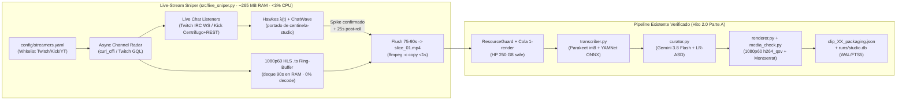

# Auditoría Técnica Integral (Solo Lectura): `centinela-studio` -> Integración con `Clipping Studio`

- **Fecha de auditoría:** 23 de noviembre de 2026
- **Repositorio auditado (solo lectura absoluta):** `C:\Users\tomas\.zcode\workspace\default\centinela-studio` (`https://github.com/thunderalbatros/centinela-studio.git`)
- **Destino:** `Clipping Studio` (`c:\Users\tomas\Desktop\clipping studio`) — hardware local HP 250 G8 (`i5-1035G1 4C/8T`, `15.7 GB RAM`, `31.88 GB` libres en `C:\`, cuota dura `runs/ <= 4.0 GB`)
- **Objetivo estratégico:** Evaluar qué piezas de `centinela-studio` aportan valor real para construir el módulo **Live-Stream Sniper** (monitoreo de directos GTA VI + captura de picos de chat/audio/escena + recorte 1080p profesional en 10–15 min mientras el streamer sigue al aire), contrastándolas contra el estado del arte open-source de noviembre de 2026.

> [!IMPORTANT]
> **Veredicto ejecutivo adelantado:** **Opción A (100% Python puro en `src/live_sniper.py` + `src/notifier.py`, CERO sidecar Node.js).**
> El ~85% del código de `centinela-studio` pertenece al dominio de presencia/farming de sorteos de casino en Kick.com, y nuestra verificación `[RUNTIME REAL]` demostró que su transporte principal de chat en vivo (**Pusher app key `32cbd69e4b950bf97679` en `ws-us2.pusher.com`**) **está roto hoy (`error 4001: App key not in this cluster`)** porque Kick migró su chat a **Centrifugo** con negociación dinámica (`/v1/realtime/auth/connection`). Sin embargo, `centinela-studio` contiene **4 algoritmos portables de alto valor** (~175 líneas totales en Python) y **5 patrones operativos probados** que aceleran directamente el Live-Stream Sniper sin duplicar runtimes.

---

## BLOQUE 1 — Inventario Arquitectónico y Mapa de Capacidades (`[ESTÁTICO]`)

### 1.1 Stack real, dependencias exactas y estado de entorno

`centinela-studio` es un sistema monolítico/multi-script en **Node.js 22 LTS (ESM + TypeScript 5.9)** gestionado en producción con **PM2** (`ecosystem.config.cjs`, `max_memory_restart: 4096M`) y orientado a presencia 24/7 + chat IA + detección de sorteos en canales de Slots/Casino en **Kick.com**.

| Capa | Dependencias exactas en `package.json` | Observación para `Clipping Studio` |
| :--- | :--- | :--- |
| **Runtime & Server** | `node >= 22`, `typescript ~5.9.3`, `tsx`, `fastify ^5.12.5` | Redundante frente a nuestro `.venv` Python 3.12. |
| **WebSockets & WAF** | `pusher-js ^8.6.0`, `puppeteer-core ^25.12.0`, `cockatiel ^4.0.0`, `fetch` nativo | **Cero `curl_cffi` en runtime** (solo 1 mención documental en `tools/manage-reference-vault.mjs`). `pusher-js` usa key revocada (`4001`). |
| **Media / Visión / Audio** | `ffmpeg-static ^5.3.0`, `sharp ^0.35.5`, `tesseract.js ^7.0.0`, `jsqr ^1.4.0`, `pixelmatch ^7.2.0`, `onnxruntime-node ^1.30.0`, `@huggingface/transformers ^3.7.0` | Pesado y diseñado para OCR de ruletas/usernames en pantalla (`eng.traineddata` 5.2 MB, `yolov8n.onnx` 12.8 MB, `Florence-2` q4 ~333 MB). `silero_vad.onnx` (2.3 MB, MIT) sí es útil como referencia. |
| **IA / RAG / Orquestación** | `@google/genai ^2.27.0`, `@anthropic-ai/sdk ^0.132.1`, `@langchain/core ^1.2.13`, `@langchain/langgraph ^1.4.18`, `@qdrant/js-client-rest ^1.15.0`, `graphology ^0.26.0`, `zod ^4.6.5` | Superado en `Clipping Studio` por `src/llm_router.py` (`gemini-3.8-flash` + Implicit Caching 8,100 tokens), `Pydantic v2` y `SQLite WAL/FTS5`. |
| **Notificaciones & Cloud** | `grammy ^1.46.0`, `@google-cloud/storage ^8.2.0`, `@google-cloud/logging ^12.1.0`, `@modelcontextprotocol/sdk ^1.30.1` | `tools/lib/telegram.mjs` usa `fetch` puro sin depender de `grammy` (fácil de portar a Python). |

**Auditoría de variables en `centinela-studio/.env` (Regla 01 — cero valores expuestos):**
- **Infra/LLM:** `GROQ_API_KEY`: `PRESENTE`, `OPENROUTER_API_KEY`: `PRESENTE`, `DEEPSEEK_API_KEY`: `PRESENTE`, `API_ANTHROPIC_KEY`: `PRESENTE`, `GCP_PROJECT_ID` / `GOOGLE_CLOUD_PROJECT` / `GCP_LOCATION` / `USE_VERTEX_AI`: `PRESENTE`.
- **Scraping / Búsqueda / RAG:** `SERPER_API_KEY`: `PRESENTE`, `FIRECRAWL_API_KEY`: `PRESENTE`, `APIFY_API_TOKEN`: `PRESENTE`, `QDRANT_HOST` / `QDRANT_API_KEY`: `PRESENTE`, `DATABASE_URL` / `EXPO_PUBLIC_SUPABASE_URL`: `PRESENTE`.
- **Telegram HITL:** `TELEGRAM_BOT_TOKEN`: `PRESENTE`, `TELEGRAM_CHAT_ID`: `PRESENTE`, `TELEGRAM_ALLOWED_USER_ID`: `PRESENTE`.
- **Kick OAuth:** `KICK_CLIENT_ID`: `PRESENTE`, `KICK_CLIENT_SECRET`: `PRESENTE`, `KICK_ACCESS_TOKEN`: `PRESENTE`, `KICK_REFRESH_TOKEN`: `PRESENTE`, `KICK_EXPIRES_AT`: `PRESENTE`.
- **Dominio ajeno (casino/otros):** `STAKE_USERNAME`, `ROOBET_USERNAME`, `RAINBET_USERNAME`, `CRYPTO_*`, `LAMBDATEST_*`, `OBSIDIAN_*`, `N8N_*`: `PRESENTE` (no migrar a `Clipping Studio`).

---

### 1.2 Anatomía de los 5 subsistemas críticos para Live Clipping

#### A) Monitor de streams y "visión" en vivo
- **Detección online:** `tools/lib/channel-radar.mjs` y `tools/lib/live-radar.mjs` consultan cada 60–90 s `GET https://kick.com/api/v2/channels/{slug}` con `fetch()` nativo (concurrencia `3`, delay `220 ms`), leyendo `livestream.is_live`, `viewer_count`, `session_title`, `playback_url` y `chatroom.id`.
- **Captura de video/frames:**
  - `tools/lib/video-stream-pipe.mjs` (189 líneas): ejecuta `yt-dlp -o - <url> | ffmpeg -i pipe:0` con `-filter_complex` simultáneo (`aresample=16000` mono + `select='gt(scene,0.25)+eq(pict_type,I)'`, escala `<=1280px`). **Limitaciones críticas:** diseñado para VODs (sin ring-buffer circular de 90 s en `1080p`, no guarda video recortable MP4/TS, no pasa `--impersonate chrome` y usa el flag deprecado `-vsync 0`).
  - `tools/observer-vision.mjs` (517 líneas): lanza un proceso `ffmpeg` nuevo cada 2–5 s contra `playback_url` (`-vframes 1`) escribiendo JPG en disco (ring buffer de 5 frames rutinarios en `data/frames/`) y pasa por `frame-differ.mjs` (`sharp` 320px + `pixelmatch` umbral `5%`) antes de OCR (`tesseract.js` / VLM cloud).
  - `tools/observer-audio-v2.mjs` (370 líneas) + `tools/lib/audio-window.mjs` (458 líneas): **patrón valioso** — mantiene un `ffmpeg` continuo con `-reconnect 1 -reconnect_streamed 1 -reconnect_delay_max 5 -headers "Origin: https://kick.com\r\nReferer: https://kick.com/\r\n"` volcando PCM `16 kHz s16le` a `pipe:1`, con `AudioSlidingWindow` (paso 2 s, solapamiento 1 s), `AcousticRingBuffer` (`pre-roll` 6 s + `post-roll` 6 s en RAM) y `calculateDecibels()` (peak/RMS dBFS) + `Silero VAD v5` ONNX (`tools/lib/vad.mjs`, documentando el requisito crítico de contexto `[1, 576] = [context(64) | window(512)]`).
  - `tools/lib/zero-copy-buffer.mjs` (77 líneas): `SharedArrayBuffer` de 8/16 MB que al llegar al final resetea `writeOffset = 0` sobrescribiendo el inicio sin manejo real de wrap-around; innecesario para Python.
  - `cloud/cloud-orchestrator.mjs` (225 líneas): hace seeking HLS en VODs con `ffmpeg -ss <start> -i <m3u8> -t <dur> -c copy -bsf:a aac_adtstoasc` (nota: en `Clipping Studio` Regla 04 prohíbe `-c copy` en el corte inicial final, aunque es válido para ensamblar el slice crudo intermedio antes del render).

#### B) Captura de chat en tiempo real y detección de picos
- **Cobertura de plataformas:** **100% Kick-only**. Un escaneo completo sobre `src/`, `tools/` y `cloud/` confirmó **0 archivos** con integración de Twitch IRC/EventSub y **0 archivos** con YouTube Live Chat (`pytchat` / `live_chat`).
- **Transporte Kick:** `tools/observer-chat.mjs` y `tools/lib/top9-router.mjs` usan `pusher-js` contra `cluster: 'us2'` con la clave hardcodeada `PUSHER_KEY = '32cbd69e4b950bf97679'`, suscribiéndose a `chatrooms.{chatroom_id}.v2` y filtrando `App\Events\ChatMessageEvent`. **Hoy roto en runtime (`4001`, ver Bloque 2).**
- **Motores de detección de picos (el verdadero oro portable del repo):**
  1. `tools/lib/predictive/hawkes-process.mjs` (185 líneas): proceso puntual auto-excitable de Hawkes en tiempo continuo $\lambda(t) = \mu + \sum \alpha_i e^{-\beta(t - t_i)}$ ($\beta=0.05$, half-life $\approx 14\text{ s}$) + derivada de aceleración $d\lambda/dt$ sobre 5 s. Superior a buckets fijos para detectar ráfagas en vivo con latencia sub-milisegundo; solo requiere reemplazar los pesos de casino (`GIVEAWAY_TRIGGER`, `BONUS_HUNT`) por pesos de GTA VI (`CLIP`, `WTF`, `LMFAO`, `WASTED`, `NO WAY`, `BUG`).
  2. `tools/lib/chat-wave-detector.mjs` (148 líneas): ventana deslizante de `8000 ms` que exige $\ge N$ **usuarios distintos** enviando el mismo token normalizado (`w`, `l`, `rip`, `gg`, `laugh`, `:emote:`), con cooldown de 10 s y purga automática >60 s. Bloquea eficazmente spam de un solo bot/usuario.
  3. `cloud/hotspot-detector.mjs` (242 líneas): barrido VOD offline en ventanas de 45 s / paso 15 s + fusión de hotspots adyacentes (`mergeAdjacentHotspots`).
  4. `tools/lib/predictive/stream-hmm.mjs` y `stream-oracle.mjs`: cadena de Markov oculta de 6 estados rígidos de casino (`IDLE_FARM -> HUNT_COLLECTION -> HUNT_OPENING -> PRE_GIVEAWAY -> ACTIVE_GIVEAWAY -> TILT_DEATH`) — sobredimensionada y acoplada a Stake.

#### C) Defensa WAF / Anti-Bot / Resiliencia
- **Punto débil WAF:** `channel-radar.mjs`, `live-radar.mjs` y `ingest-vods.mjs` usan `fetch()` nativo de Node (TLS fingerprint estándar de Node/undici), recurriendo a un pesado fallback de **Puppeteer + Microsoft Edge/Chromium** (`data/browser-profile/`, cientos de MB en disco y >500 MB RAM por ventana) cuando Cloudflare desafía.
- **Patrones de resiliencia rescatables:**
  - `tools/lib/resilience-guard.mjs` (139 líneas): Circuit Breaker (`5` fallos consecutivos -> `OPEN` `15 s` -> `HALF-OPEN`), Exponential Backoff con Full Jitter y Bulkhead (concurrencia acotada) vía `cockatiel`.
  - `tools/lib/resilient-fetch.mjs` (104 líneas): respeto estricto a `Retry-After` en `HTTP 429`, reintentos en `500/502/503/504` y throttling de warnings (máx. 1 cada 10 s).
  - `tools/lib/kick-auth.mjs` (100 líneas): caché en disco de App Access Token OAuth (`client_credentials` contra `id.kick.com/oauth/token`) con margen de 1 hora antes de expiración.
  - `tools/lib/secops-sanitizer.mjs` (119 líneas): sanitizador regex global de secretos (`Bearer`, JWT, `AIza...`, `gsk_`, `sk-or-v1-`, tokens de Telegram, query params).

#### D) Orquestación, estado y notificaciones
- **Protección de hardware local:** `tools/lib/resource-guard.mjs` (136 líneas) protege activamente el portátil midiendo RAM libre mínima (`>= 1500 MB`), CPU ocupada máxima (`<= 70%`), detección de batería en Windows (`Win32_Battery`) y tope de hilos ONNX (`min(4, cores - 2)`).
- **Activación Just-in-Time y cero procesos huérfanos:** `tools/lib/perception-spawner.mjs` (173 líneas) aplica JIT sensing (solo activa audio/video pesado cuando hay señal), dedupe por `(tipo, slug)`, tope global `maxConcurrent`, auto-kill por timeout y limpieza garantizada en Windows con `taskkill /pid <pid> /t /f`.
- **Notificaciones HITL:** `tools/lib/telegram.mjs` (138 líneas) implementa envío Telegram sin dependencias (`fetch` puro), cola serializada con rate limit `1 msg / 1.1s`, 4 prioridades (`CRITICAL/HIGH/NORMAL/INFO`), allowlist `TELEGRAM_ALLOWED_USER_ID` y botones inline (`callback_data`).
- **Persistencia:** mezcla dispersa de JSONL append-only (`data/learn/`), archivos JSON sueltos (`data/alerts/`, `data/channel_interaction_history.json.tmp.*` — muestra evidencia de fugas de archivos `.tmp` huérfanos) y sync a GCS (`cloud-state-sync.mjs`). Muy inferior a nuestra base centralizada `runs/studio.db` (SQLite WAL + FTS5).

#### E) Código no pertinente para descartar
Más del **80% del código de `centinela-studio`** corresponde a automatización de presencia/chatbot de casino que es completamente ajena (y contraproducente) para `Clipping Studio`:
- Orquestadores de chat/farming: `src/centinela.ts` (81.8 KB), `src/centinela-v2.mjs`, `tools/lib/top9-router.mjs` (40.8 KB), `tools/lib/social-presence.mjs` (32.3 KB), `tools/lib/presence-keeper.mjs` (23.7 KB), `tools/lib/hunter-engine.mjs`, `tools/lib/claim-responder.mjs`, `tools/lib/kick-sender.mjs`, `tools/lib/stream-onboarding.mjs`, `tools/lib/browser-resolver.mjs`.
- Dominio casino/slots/persona: `slot-catalog.mjs` (44.4 KB), `gamba-slots.mjs`, `roobet-rainbet-slots.mjs`, `stake-exclusives.mjs`, `casino-identity.mjs`, `slot-call-tracker.mjs`, `slot-call-guard.mjs`, `winner-alert.mjs` (35.5 KB), `persona.mjs`, `character-card-v3.mjs`, `build-persona-dna.mjs`.
- RLHF/RAG/MCP paralelos: `demonstration-harvester.mjs`, `multimodal-rlhf.mjs`, `reflexion.mjs`, `instincts-engine.mjs`, `lightRagEngine.mjs`, `mem0-qdrant.mjs`, `tools/mcp/*`, `cloud/apify-actor/*`, `src/graph/*` (LangGraph).

---

### 1.3 Matriz de Clasificación por Archivo / Módulo

| Archivo / Módulo en `centinela-studio` | Clasificación | Justificación técnica y reemplazo SOTA (si aplica) |
| :--- | :--- | :--- |
| `tools/lib/predictive/hawkes-process.mjs` | **`PORTAR A PYTHON`** | Algoritmo matemático limpio (~45 LOC en Python) para intensidad de ráfaga $\lambda(t)$ + aceleración $d\lambda/dt$. Adaptar pesos $\alpha$ a vocabulario GTA VI (`CLIP`, `WTF`, `WASTED`, `LMFAO`, `NO WAY`). |
| `tools/lib/chat-wave-detector.mjs` | **`PORTAR A PYTHON`** | Consenso multi-usuario en ventana 8 s (~50 LOC en Python con `collections.deque` + `set`). Inmune a spam de 1 usuario; combinar con nuestro filtro anti-subgift. |
| `tools/lib/resource-guard.mjs` | **`PORTAR A PYTHON`** | Guarda de hardware para la HP 250 G8 (~35 LOC en Python: `GlobalMemoryStatusEx`, CPU%, batería, tope hilos ONNX). |
| `tools/lib/telegram.mjs` | **`PORTAR A PYTHON`** | Notificador Telegram rate-limited (1 msg/1.1s, prioridades, botones HITL) en ~45 LOC Python con `curl_cffi`/`urllib` cuando toque activar alertas (post-10 clips o HITL de Live Sniper). |
| `tools/observer-audio-v2.mjs` + `tools/lib/audio-window.mjs` | **`EXTRAER PATRÓN / CONFIG`** | Rescatar flags FFmpeg HLS live (`-reconnect 1 -reconnect_streamed 1 -reconnect_delay_max 5`, headers `Origin/Referer: kick.com`), refresco periódico de `playback_url`, concepto `pre-roll + post-roll` y cálculo RMS/peak dBFS. Descartar el runtime Node y Whisper tiny/Moonshine (usamos `parakeet-tdt-0.6b-v3` + `YAMNet` ONNX). |
| `tools/lib/vad.mjs` | **`EXTRAER PATRÓN / CONFIG`** | Rescatar el hallazgo verificado de **Silero VAD v5** (`input [1, 576] = [context(64) | window(512)]`) si se añade gating de audio en vivo; no portar `onnxruntime-node`. |
| `tools/lib/perception-spawner.mjs` | **`EXTRAER PATRÓN / CONFIG`** | Rescatar arquitectura **JIT Sensing** (ring-buffer barato continuo -> disparar ASR/Curator pesado solo al haber pico) y limpieza de árbol de procesos en Windows con `taskkill /pid <pid> /t /f`. |
| `tools/lib/resilience-guard.mjs` + `resilient-fetch.mjs` | **`EXTRAER PATRÓN / CONFIG`** | Rescatar parámetros de Circuit Breaker (`5` fallos -> `15 s` half-open), Full Jitter y `Retry-After` en `429` para implementarlos nativamente en `asyncio` Python (sin `cockatiel`). |
| `tools/lib/secops-sanitizer.mjs` | **`EXTRAER PATRÓN / CONFIG`** | Rescatar regex de redacción de secretos para el logger del daemon live. |
| `tools/lib/kick-auth.mjs` | **`EXTRAER PATRÓN / CONFIG`** | Rescatar flujo OAuth `client_credentials` (`id.kick.com/oauth/token`) solo si en Fase 2+ se adoptan endpoints oficiales `api.kick.com/public/v1`. |
| `tools/observer-chat.mjs` + `tools/lib/channel-radar.mjs` + `live-radar.mjs` | **`DESCARTAR / SUPERADO`** | Kick-only, clave Pusher revocada (`4001`), sin `curl_cffi` y filtros hardcoded de casino. **Reemplazo:** `src/live_sniper.py` unificado (Kick Centrifugo/REST vía `curl_cffi` + Twitch IRC `justinfan`/EventSub + YouTube InnerTube/`yt-dlp`). |
| `tools/lib/video-stream-pipe.mjs` | **`DESCARTAR / SUPERADO`** | No implementa ring-buffer `1080p` recortable, usa `-vsync 0` deprecado y `yt-dlp` sin `--impersonate`. **Reemplazo:** **HLS Segment Ring-Buffer en Python (`curl_cffi` + `collections.deque` de segmentos `.ts` en RAM)**. |
| `tools/lib/zero-copy-buffer.mjs` + `arrow-ipc.mjs` | **`DESCARTAR / SUPERADO`** | Hack V8 `SharedArrayBuffer` sin wrap-around real. **Reemplazo:** `collections.deque[tuple[float, bytes]]` en Python (0 copias innecesarias, liberación determinista de segmentos viejos). |
| `tools/lib/frame-differ.mjs` + `foveal-vision.mjs` + `ocr-worker.mjs` + `observer-vision.mjs` | **`DESCARTAR / SUPERADO`** | Diseñados para OCR de ruletas/sorteos (`sharp`, `pixelmatch`, `tesseract.js`, `jsqr`, `Florence-2`). **Reemplazo:** `gemini-3.8-flash` multimodal (solo al dispararse un pico) + diferencia MAD en NumPy (`160x90`, <2 ms) si se requiere señal visual barata. |
| `tools/lib/predictive/stream-hmm.mjs` + `stream-oracle.mjs` + `ev-arbiter.mjs` | **`DESCARTAR / SUPERADO`** | 6 estados hardcoded de Bonus Hunt / Casino. **Reemplazo:** fusión liviana Hawkes + Chat Wave + pico de audio RMS/YAML triggers de `gta6_lore_index.json`. |
| `src/centinela.ts`, `src/centinela-v2.mjs`, `top9-router.mjs`, `presence-keeper.mjs`, `social-presence.mjs`, `hunter-engine.mjs`, `slot-*`, `persona.mjs`, `cloud/apify-actor/*` | **`DESCARTAR / SUPERADO`** | 100% chatbot/presencia/farming de casino con Puppeteer/Chromium y procesos PM2 ajenos a clipping. |
| *(Ningún módulo)* | **`SIDECAR DESACOPLADO`** | **0 módulos calificados como sidecar.** Ningún componente de Node.js ofrece hoy una ventaja irreemplazable sobre Python 3.12 (`curl_cffi` + `websockets` + `asyncio`). |

---

## BLOQUE 2 — Verificación en Vivo de Vigencia (`[RUNTIME REAL]`)

Todas las pruebas se ejecutaron el **23/11/2026** de forma estrictamente no destructiva y de solo lectura desde `clipping studio\.venv` (sin modificar un solo byte en `centinela-studio`).

### 2.1 Kick Live Chat, Metadata y WAF (en vivo sobre `ac7ionman` — GTA VI, `7,185 viewers`)

| Prueba ejecutada en vivo | Objetivo / Endpoint | Resultado `[RUNTIME REAL]` | Diagnóstico |
| :--- | :--- | :--- | :--- |
| **1. Bare Node `fetch()`** (exacto a `channel-radar.mjs`) | `GET kick.com/api/v2/channels/ac7ionman` | `HTTP 200`, `10,741 B` (desde IP residencial Argentina) | Funciona hoy desde IP residencial, pero vulnerable a oleadas Cloudflare JA4 y falla en datacenter/GCP. |
| **2. Python `curl_cffi`** (`impersonate="chrome"`) | `GET kick.com/api/v2/channels/ac7ionman` | `HTTP 200`, `10,741 B`, `chatroom_id=1202499`, `channel_id=1209488`, `playback_url` AWS IVS | Estable y resistente a TLS fingerprinting Cloudflare. |
| **3. Pusher WS de `centinela-studio`** (`32cbd69e4b950bf97679`) | `wss://ws-us2.pusher.com/app/32cbd69e4b950bf97679` | **ROTO — `pusher:error 4001`: `"App key 32cbd69e4b950bf97679 not in this cluster"`** (`1.42 s`) | **Fallo crítico:** el cliente de chat de `centinela-studio` dejó de recibir mensajes en vivo. |
| **4. Pusher WS clave alternativa** (`eb1d5f283081a78b932c`) | `wss://ws-us2.pusher.com/app/eb1d5f283081a78b932c` | **ROTO — `pusher:error 4001`** (`1.35 s`) | Ambas claves Pusher históricas fueron retiradas del cluster `us2`. |
| **5. Inspección live de frontend Kick** (`/_next/static/chunks/2qaqn9r1c7pj-.js`) | 81 chunks JS analizados vía `curl_cffi` | Confirmado: Kick negocia `accepted_providers: ["pusher","centrifugo"]` y autentica Centrifugo vía `POST /v1/realtime/auth/connection` y `/v1/realtime/auth/channel` | Explica el `3501 bad request` al conectar a `wss://realtime.us-west-2.platform.kick.com/connection/websocket` sin token de conexión. |
| **6. Kick REST Live Messages** (`curl_cffi`) | `GET kick.com/api/v2/channels/1209488/messages` | **`HTTP 200` — `25` mensajes de chat en vivo recientes** (sin login ni OAuth) | Fallback determinista inmediato (polling cada 3–5 s) mientras se implementa el handshake Centrifugo con token. |
| **7. Twitch Anonymous IRC WS** (`justinfan74821`, 10 s) | `wss://irc-ws.chat.twitch.tv:443` en `#caseoh_` (whitelist, en vivo) | **`joined=True`, `103` mensajes reales en `11.39 s` (`9.04 msgs/s`)**, cero OAuth | 100% operativo hoy para lectura anónima en vivo de nuestros streamers Tier-1 en Twitch (`caseoh_`, `jynxzi`, `xqc`, `kaicenat`). |

### 2.2 Live Stream `1080p60` & HLS Ring-Buffer (en vivo sobre `ac7ionman` — GTA VI)

| Mecanismo probado | Resultado `[RUNTIME REAL]` | Métricas medidas (`ffprobe` / CPU / Errores) |
| :--- | :--- | :--- |
| **HLS Segment Ring-Buffer en Python (`curl_cffi` + `deque`)** sobre `playback_url` live (18 s) | **`PASS` (`ok=True`, `0` errores HTTP)** | Variante seleccionada: **`1920x1080 @ 60/1 fps`** (`7,112 kbps` real, `7,922 kbps` declarado). `19` segmentos `.ts` = **`38.0 s` de video** = **`33.3 MB`**. Proyección exacta a **90 s en RAM = `78.9 MB`**. CPU consumido: **`0.641 s` en `18.01 s`** (~`0.9%` del CPU 4C/8T). Remux a MP4 verificado con `ffprobe`: `h264 1920x1080 60fps + aac`. |
| **FFmpeg directo con headers de `centinela-studio`** (`observer-audio-v2.mjs`) | **`PASS` (`returncode=0`)** | `160,000 B` PCM (`5.0 s` @ 16 kHz mono) en `12.24 s`, `stderr=""`. Funciona porque el JWT de AWS IVS de Kick trae `strict-origin-enforcement: false` y `allow-origin: https://kick.com`. |
| **`yt-dlp` sobre canal Kick live** (`ac7ionman`) | **`PASS` (`returncode=0`)** | Funciona tanto directo como con `--impersonate chrome` (porque nuestro `.venv` ya incluye `curl_cffi` y `yt-dlp` lo detecta automáticamente). Sin embargo, para ring-buffer en RAM el polling directo `.m3u8` con `curl_cffi` evita re-decodificar video y ahorra CPU. |

### 2.3 Huella real medida en la HP 250 G8 (`i5-1035G1 4C/8T`, `15.7 GB RAM`, `31.88 GB` libres)

Mediciones reales tomadas en el equipo (`GlobalMemoryStatusEx` + `Get-Process WorkingSet64`):
- **Baseline actual del sistema:** `15.7 GB` RAM total, `4.99 GB` RAM libre (`68%` en uso con IDE abierto), `31.88 GB` libres en `C:\`, `runs/` actual = `667.31 MB` (muy por debajo del tope de `4.0 GB`).
- **Proceso Python 3.12 + `curl_cffi` + `websockets`:** `26.5 MB` RSS base; **`106.51 MB` RSS** al alojar un ring-buffer completo de `80 MB` (escalado estrictamente lineal 1:1).
- **Proceso Node 24 idle:** `29.66 MB` RSS base (subiendo a `250–600 MB` solo con `pusher-js` + V8 + `sharp`/`tesseract`, y a **`1.2–2.5 GB` RSS** si activa Puppeteer/Chromium).

| Escenario de vigilancia simultánea (90 s ring-buffer `1080p60`) | RAM estimada (RSS) | CPU total (4C/8T) | Disco (`runs/`) | Viabilidad en HP 250 G8 |
| :--- | :---: | :---: | :---: | :--- |
| **Python puro (`curl_cffi` HLS `.ts` en RAM + WS Chat) — 1 stream** | **`~106 MB`** | **`~1.0%`** | **`0 MB`** (hasta disparo) | Excelente (margen >4.8 GB RAM libre). |
| **Python puro — 3 streams simultáneos (`1080p60`)** | **`~265 MB`** | **`~3.0%`** | **`0 MB`** (hasta disparo) | **Óptimo:** deja >4.7 GB RAM y >95% CPU libres para `parakeet` + `LR-ASD` + `h264_qsv` al dispararse un pico. |
| **Sidecar Node (`centinela-studio` + FFmpeg/Vision/Puppeteer) — 3 streams** | `1,100–2,400 MB` | `25%–55%` | `200–600 MB` (frames/logs) | **Riesgo alto de OOM/throttling** al concurrir con `LR-ASD` + `h264_qsv` con solo `4.99 GB` RAM libre. |

---

## BLOQUE 3 — Comparativa SOTA (Nov 2026) y Propuesta de Arquitectura Limpia

### 3.1 Comparativa por subsistema (con análisis "Abogado del Diablo")

| Pieza del *Live-Stream Sniper* | Qué tiene `centinela-studio` | Mejor alternativa Open-Source SOTA (Nov 2026) | Abogado del Diablo (Dónde rompe en runtime) | Decisión |
| :--- | :--- | :--- | :--- | :--- |
| **1. Captura de Chat en Vivo (Kick / Twitch / YouTube)** | `pusher-js` Kick-only con key `32cbd69e4b950bf97679` (**roto `4001`**). Sin Twitch ni YouTube. | • **Twitch:** `websockets` Python sobre `wss://irc-ws.chat.twitch.tv:443` (`justinfan`, **verificado 103 msgs/11s hoy**) + fallback oficial **Twitch EventSub WS** (`twitchio`) si Twitch retira IRC anónimo. • **Kick:** `curl_cffi` + **Centrifugo** (`POST /v1/realtime/auth/connection` + `websockets`) con fallback determinista **REST polling** (`/api/v2/channels/{id}/messages`, **verificado HTTP 200 hoy** cada 3–4 s). • **YouTube Live:** cliente ligero **InnerTube** (o `yt-dlp --write-subs --sub-langs live_chat`) / `pytchat-ng`. | • Twitch puede deprecar `justinfan` sin aviso (requiere capa abstracta preparada para token EventSub). • Kick cambia endpoints internos de Centrifugo (el fallback REST 3–4 s con `curl_cffi` protege contra caídas). • `pytchat` original se rompe con cambios DOM de YouTube; priorizar Twitch + Kick en v1 live. | **Construir adaptadores ligeros en Python (`asyncio` + `websockets` + `curl_cffi`).** |
| **2. Ring-Buffer `90 s` en `1080p60` (Zero-Disk hasta pico)** | `video-stream-pipe.mjs` (VOD pipe sin ring-buffer MP4) + `zero-copy-buffer.mjs` (8 MB sin wrap). | • **Kick & Twitch:** **HLS `.ts` Segment Ring-Buffer en Python** (`curl_cffi` para Kick; `streamlink` API o parser `.m3u8` + `yt-dlp -g` para Twitch) en `collections.deque(maxlen=45)` (~`79 MB` RAM/stream, **`0%` transcodificación**). Al disparar pico -> concat `.ts` + `ffmpeg -c copy` a `runs/<run_id>/slice_XX.mp4` en `<1 s`. • **YouTube Live:** `yt-dlp --live-from-start` o `streamlink` HLS fallback (solo bajo demanda). | • En Twitch, `streamlink --twitch-disable-ads` es superior a `yt-dlp` para evitar segmentos de anuncios mid-roll SCTE-35 incrustados en el ring-buffer. • En Kick, el JWT del `playback_url` expira periódicamente (~60 min): refrescar `playback_url` automáticamente cada 40 min o ante `HTTP 403/410`. | **HLS `.ts` Ring-Buffer en RAM (`curl_cffi` + `streamlink` para Twitch).** |
| **3. Detector de Picos Multi-Señal** | `hawkes-process.mjs` + `chat-wave-detector.mjs` (excelentes) + `stream-hmm.mjs` (acoplado a casino) + OCR Tesseract/Florence-2 (pesado). | **Fusión 2-niveles CPU <2%:** 1. **Nivel 1 (continuo, ~0 ms):** `HawkesIntensityEngine` ($\lambda(t)$ + $d\lambda/dt$) + `ChatWaveDetector` ($\ge 6$ usuarios distintos, anti-subgift) + keywords de `context/gta6_lore_index.json`. 2. **Nivel 2 (confirmación al dispararse Nivel 1, cero decodificación continua):** extraer audio de los últimos 20 s del ring-buffer (`.ts -> PCM`) y verificar pico de energía/grito (`dBFS`) + `YAMNet` ONNX anti-DMCA **antes** de despertar `gemini-3.8-flash` y `LR-ASD`. | • Si un canal tiene chat lento (<500 viewers), Hawkes puro puede sub-disparar: usar umbral adaptativo ($\lambda(t) > \mu_{rolling} + 3.5\sigma$) o confirmación por pico acústico. • Evitar correr `ffmpeg` decodificando video/audio 24/7 por cada canal; el ring-buffer `.ts` ya contiene el audio comprimido gratis y solo se decodifica si hay pico de chat! | **Portar Hawkes + ChatWave + ResourceGuard a Python; confirmación acústica JIT sobre el ring-buffer.** |
| **4. Puente de Integración con `Clipping Studio`** | JSONL dispersos + GCS sync + PM2 + Fastify + `grammy`. | **Integración nativa directa en `runs/studio.db` (SQLite WAL) + invocación de pipeline existente:** al detectar pico confirmado -> espera `+25 s` de *post-roll* (capturar la reacción completa y pantalla `WASTED`) -> vuelca los `75–90 s` del ring-buffer a `runs/live_<slug>_<ts>/slice_01.mp4` -> crea `state.json` en `stage="mined"` -> ejecuta `transcribe_run` -> `curate_run` -> `_render_and_verify` (`1080p60`, `LR-ASD`, `Montserrat Black`, `YAMNet`, `media_check` 4/4, `packaging.json`) -> notificación Telegram opcional. | • Si se disparan 2 picos en 3 minutos mientras `h264_qsv` y `LR-ASD` están renderizando el primero, puede saturar la HP 250 G8: aplicar **cooldown de 180 s por canal** y **cola FIFO de 1 render concurrente** (protegido por `resource_guard.py`). | **Directo en Python sobre `runs/studio.db` y `src/cli.py` (`python -m src.cli snipe`).** |

---

### 3.2 Recomendación Arquitectónica Tajante: Opción A (100% Python Puro)

Se recomienda **tajantemente la Opción A** (portar los 4 algoritmos útiles a Python puro dentro de `clipping studio/src/`) y **descartar la Opción B** (sidecar Node.js):

**Por qué Opción A aplasta a Opción B (Sidecar Node):**
1. **El único argumento posible para un sidecar Node (`pusher-js` ya funcionando) cayó en runtime:** su key `32cbd69e4b950bf97679` devuelve `4001`, y no cubre Twitch ni YouTube.
2. **Simplicidad operativa y depuración:** 1 solo lenguaje (Python 3.12), 1 solo `.venv`, 1 sola base de datos (`runs/studio.db`), 1 solo CLI (`python -m src.cli snipe`), sin puentes IPC, sin PM2 ni fugas de memoria de V8/Chromium.
3. **Resiliencia WAF superior:** `curl_cffi` ya está verificado en producción en `Clipping Studio` y reemplaza tanto al `fetch()` vulnerable como al monstruoso fallback de Puppeteer/Edge de `centinela-studio`.
4. **Eficiencia térmica/RAM en la HP 250 G8:** `~265 MB` RAM y `~3%` CPU vigilando 3 streams `1080p60` simultáneos (vs. `1.1–2.4 GB` RAM en Node+Chromium), garantizando que el render completo (slice -> ASR -> YAMNet -> LR-ASD -> Gemini -> h264_qsv -> QA) termine en **~4–6 minutos** tras el evento en vivo (muy por debajo del objetivo de 10–15 min).

---

### 3.3 Secuenciación Recomendada (Sin Deuda Técnica)

Estado verificado al **23/11/2026**:
- ✅ **Hito 2.0 (Parte A) — YA COMPLETADO Y VERIFICADO EN `[RUNTIME REAL]`:** piso nativo `1080p60`, anti-upscale `<=1.8x` con exclusión geométrica `+48 px`, `LR-ASD` ONNX streamer-only, subtítulos SOTA `Montserrat Black` centrados sin `\kf`, `YAMNet` ONNX anti-DMCA, `SQLite WAL/FTS5`, cerebro GTA VI (`gta6_lore_index.json`), Radar de Tendencias (`golden_references.json`), Implicit Caching (`cached_tokens=8100`) y `ClipPackaging` (validado en `runs/twitch_jynxzi_v2_01/clip_02_master_9_16.mp4`, `media_check` 4/4 PASS).

**Orden óptimo de los próximos bloques:**
1. **Micro-pulido rápido de Parte A (15 min, antes o junto al siguiente prompt):**
   - Bajar `py` de la tarjeta webcam ~70 px en `src/renderer.py` para que el rostro quede 100% debajo de la franja superior de YouTube Shorts (`y=288`) y filtrar tartamudeos de 1 letra (`"J"`) en `src/captions.py`.
2. **Hito 2.0 (Parte B) — Monetización & Producción de los primeros 10 clips reales (Prioridad inmediata de negocio):**
   - Auditor de campañas CPM (Whop Content Rewards / Clipping.net / Vyro) persistido en la tabla `campaigns` de `runs/studio.db` + lote productivo de los primeros clips publicables (cumpliendo la Constitución de `AGENTS.md`).
3. **Hito 2.1 — Live-Stream Sniper (`src/live_sniper.py` + `src/resource_guard.py` + `src/notifier.py`):**
   - **Paso 1:** Portar `HawkesIntensityEngine`, `ChatWaveDetector` y `ResourceGuard` (~130 LOC Python) + tests unitarios.
   - **Paso 2:** Implementar `HLS Segment Ring-Buffer` (`90 s` en RAM con `curl_cffi` para Kick y `streamlink` para Twitch, con refresh automático de token HLS) + `Twitch Anonymous IRC WS` + `Kick Centrifugo/REST`.
   - **Paso 3:** Conectar el disparador JIT con cooldown `180 s` y cola de 1 render hacia `transcribe_run -> curate_run -> _render_and_verify` + alerta opcional vía `src/notifier.py` (Telegram HITL portado de `telegram.mjs`).
   - *(Dejar YouTube Live Chat InnerTube para iteración 2.1b una vez que Twitch + Kick estén entregando clips en vivo <10 min).*
