# Auditoría Transversal Post-`v3.5.2`, Diagnóstico Visual/RAG, Stack SOTA (Ago–Nov 2026) y Plan de Evolución hacia Director Autónomo

- **Fecha de auditoría:** `2026-11-24` | **HEAD auditado:** `c7831cc` (`v3.5.2`)
- **Alcance verificado directamente:**
  - **Código y configuración (`[ESTÁTICO]`):** `25` módulos en `src/`, `evals/media_check.py`, `scripts/security_pretool_hook.py`, `config/*.yaml`, `.agents/hooks.json`, `7` skills en `.agents/skills/`, `pyproject.toml` y `.github/workflows/ci.yml`.
  - **Entregables multimedia y base viva (`[RUNTIME REAL]`):** inspección multimodal píxel a píxel de `clip_02_cover_9_16.jpg`, `qa_frame_1/2/3_safezones.png`, `02_overlay_peak.png`, `clip_02_critic_strip.png`, `runs/test_compile_16_9/thumbnail_1280x720.jpg`, `carril_a_avatar_v1.png` y `carril_a_banner_v1.png`; consulta de `runs/studio.db` (`114` chunks RAG / `114` vectores, `knowledge_chunks`, `campaigns`, `clips`, `telemetry`), `ffprobe` real de MP4s y auditoría de truncamientos en `context/*.json`.
  - **Investigación externa y docs Gemini (`2026-08-24` a `2026-11-24`):** releases verificados de plataformas (YouTube Oct 1, 2026; Whop Fall 2026; TikTok Oracle US; IG Fall 2026), OSS comercial (`HyperFrames`, `pycaps 0.3.0`, `sherpa-onnx 2.0.3`, `BiRefNet-V2`, `FastEmbed 3.0`, `sqlite-vec 0.1.9–0.1.10`, `FastMCP 4.2`, `pydantic-ai v2.50–v2.73`, `VoxCPM2`, `Qwen3-ASR`) y documentación oficial Gemini (`deprecations.md`, `pricing.md`, `caching.md`, `gemini-3.8-flash`, `gemini-3.8-flash-lite-tts`, `gemini-omni-1.2-flash`, familia `gemini-4-*`).

---

## 1. Diagnóstico Crítico y Realista del Estado Actual (`v3.5.2`)

**Veredicto sin filtro:** El endurecimiento `v3.5.2` (`c7831cc`) resolvió la mayoría de las fallas destructivas urgentes (cerró las 24 fugas SQLite en `src/db.py`, eliminó los `WinError 32` en `Image.open`, protegió `runs/branding/` y `READY_HITL` frente a `doctor`/cuota, migró `llm_router.py` a `pydantic-ai-slim==2.71.0`, bajó la RAM de `speaker_guard` de `2.33 GB` a `40.57 MB` en `tracemalloc`, recortó las instrucciones cacheadas de `55.5 KB` a `19.5 KB` y llevó `ty check src/` a `0`).

Sin embargo, si evaluamos hoy el proyecto transversalmente frente a dos objetivos reales —**(1) maximizar la probabilidad de éxito viral con estética verdaderamente profesional** y **(2) operar mediante un flujo autónomo a partir de un prompt con instrucciones**—, el proyecto todavía tiene **brechas estructurales serias** en cuatro frentes:

1. **Estética y dirección de arte rígidas + bugs visibles en salida real:** El código pasa sus 76 tests unitarios y `evals/media_check.py`, pero al mirar las imágenes reales renderizadas aparecen plantilla repetitiva portada=overlay, colisión potencial de subtítulos sobre el riel derecho y sobre la banda de overlay, tarjeta de webcam invadiendo la zona de botones derechos, un glitch negro de recorte en el thumbnail `16:9` más artefactos flotantes de `BiRefNet-lite` y un frame elegido con la mano tapando media cara del streamer.
2. **Desconexión crítica entre `curator` y `renderer` (el Crítico es ciego al resultado final):** `_run_blind_critic` audita un contact-sheet *previo* al render; **ningún agente visual audita jamás los 4 `qa_frame_*.png` finales con subtítulos, overlay y recorte ni la portada final antes de marcar `READY_HITL`**.
3. **Orquestación fragmentada (no existe aún un Director Autónomo por Prompt) + una bomba de tiempo el `1 de diciembre de 2026`:** El flujo sigue exigiendo encadenar 13 subcomandos imperativos de `cli.py`, mientras `llm_router.py` mantiene `gemini-2.5-flash` como fallback apenas **7 días antes de su apagado oficial (`2026-12-01`)**.
4. **RAG truncado y ciego a cambios de octubre–noviembre 2026:** `rag_engine.py` amputa entre **65% y 86%** de `golden_references.json`, `viral_style_dna.json` y `platform_algorithms_index.json` al cortar a `1,600` caracteres por clave; omite `4` de las `7` skills; y aún no incorpora la actualización crítica de **YouTube Shorts del 1 de octubre de 2026 ("Anti-Clipper")**, ni los **Bot Scores de Whop (Fall 2026)**.

```mermaid
flowchart LR
    U["Prompt de Usuario\n(Hoy no soportado en CLI)"] -. "Falta DirectorAgent" .-> CLI["13 subcomandos manuales\ncli.py"]
    CLI --> M["miner / live_sniper"]
    M --> T["transcriber\n(parakeet + YAMNet)"]
    T --> C["curator Pass-1/2 + BlindCritic\n(Evalua PRE-render)"]
    C --> R["renderer + callout + captions\n(h264_qsv + Chrome CDP + ASS)"]
    R --> E["evals/media_check.py\n(Solo técnico, SIN VLM visual)"]
    E --> D["DesignEngine (9:16 / 16:9)\n(Sin QA visual posterior ni loop)"]
    D --> H["HITL Kit\n(notifier NO cableado · 0 métricas vivas)"]
```

---

## 2. Qué Falta en Estructura, Entorno y Flujo para Subir Estética y Viralidad

### 2.1 Auditoría Visual Píxel a Píxel (Evidencia Real de `runs/`)

Al inspeccionar directamente las imágenes generadas en [runs/twitch_jynxzi_v2_01/](file:///c:/Users/tomas/Desktop/clipping%20studio/runs/twitch_jynxzi_v2_01) y [runs/test_compile_16_9/thumbnail_1280x720.jpg](file:///c:/Users/tomas/Desktop/clipping%20studio/runs/test_compile_16_9/thumbnail_1280x720.jpg):

| Artefacto Inspeccionado | Qué funciona bien | Defecto estético / geométrico real observado | Causa exacta en código |
| :--- | :--- | :--- | :--- |
| [clip_02_cover_9_16.jpg](file:///c:/Users/tomas/Desktop/clipping%20studio/runs/twitch_jynxzi_v2_01/clip_02_cover_9_16.jpg) y [02_overlay_peak.png](file:///c:/Users/tomas/Desktop/clipping%20studio/runs/twitch_jynxzi_v2_01/clip_02_v35_qa/02_overlay_peak.png) | Tipografía `Montserrat Black` limpia, buena jerarquía blanco + oro sobre el fuego, cero Frame 0 contaminado. | **Repetición idéntica portada = overlay:** ambos dicen exactamente `"HE DIDN'T BACK UP"` en idéntica posición (`y=668/678`), estilo y barra dorada. Esquina superior derecha de la webcam muestra un triángulo blanco residual del HUD original. | [cli.py:110-112](file:///c:/Users/tomas/Desktop/clipping%20studio/src/cli.py#L110-L112) y [curator.py:678](file:///c:/Users/tomas/Desktop/clipping%20studio/src/curator.py#L678) reutilizan la misma frase; `renderer.py:654` usa inset fijo de `6px` sin *border-snap*. |
| [qa_frame_1_safezones.png](file:///c:/Users/tomas/Desktop/clipping%20studio/runs/twitch_jynxzi_v2_01/clip_02_qa_frames/qa_frame_1_safezones.png), [qa_frame_2_safezones.png](file:///c:/Users/tomas/Desktop/clipping%20studio/runs/twitch_jynxzi_v2_01/clip_02_qa_frames/qa_frame_2_safezones.png), [qa_frame_3_safezones.png](file:///c:/Users/tomas/Desktop/clipping%20studio/runs/twitch_jynxzi_v2_01/clip_02_qa_frames/qa_frame_3_safezones.png) | Legibilidad del texto amarillo/blanco; `ffprobe` real confirma `1080x1920 yuv420p -14.2 LUFS`. | **1)** La tarjeta webcam invade claramente por derecha `x > 888` (zona de botones TikTok/Shorts). **2)** Los subtítulos usan `pos_x=540` (centro total del canvas, **no** el centro `x=468` de `[48..888]`). **3)** La banda roja en `media_check.py` dibuja `top=288` cuando `UNIVERSAL_SAFE_BOX_9_16` es `top=420`. **4)** `OVERLAY_DEFAULT_Y (678) + OVERLAY_BAND_H (440) = 1118` choca con `pos_y = 1120` de subtítulos. | [channel_profile.yaml:60](file:///c:/Users/tomas/Desktop/clipping%20studio/config/channel_profile.yaml#L60) + [captions.py:124-152](file:///c:/Users/tomas/Desktop/clipping%20studio/src/captions.py#L124-L152) (`\pos` ignora `marginr=48`); [callout.py:38-41](file:///c:/Users/tomas/Desktop/clipping%20studio/src/callout.py#L38-L41); [media_check.py:165](file:///c:/Users/tomas/Desktop/clipping%20studio/evals/media_check.py#L165). |
| [thumbnail_1280x720.jpg](file:///c:/Users/tomas/Desktop/clipping%20studio/runs/test_compile_16_9/thumbnail_1280x720.jpg) | Colores vivos, contraste legible en 160px. | **1)** **Artefacto flotante arriba del auricular** (oreja azul/HUD segmentada por error) y bloque blanco bajo el hombro. **2)** **Mano tapando boca/nariz del streamer** en el frame seleccionado. **3)** **Franja negra vertical en borde derecho (`x≈1276..1280`)**. **4)** Texto `"GTA VI CHAOS"` (placeholder genérico de `cli.py:735`) sin verdadera oclusión *Text-Behind-Subject* sobre caras de soldados al fondo. | [design_engine.py:1214-1256](file:///c:/Users/tomas/Desktop/clipping%20studio/src/design_engine.py#L1214-L1256) (`birefnet-general-lite` sin limpieza morfológica de componentes aislados ni chequeo de oclusión facial por mano); [cli.py:735](file:///c:/Users/tomas/Desktop/clipping%20studio/src/cli.py#L735). |
| [compilation_16_9_master.mp4](file:///c:/Users/tomas/Desktop/clipping%20studio/runs/test_compile_16_9/compilation_16_9_master.mp4) | `1920x1080 60fps` estable con capítulos limpios. | Compila el MP4 vertical `9:16` con pillarbox borroso en vez de usar el `slice` original `16:9` de `1920x1080`, arruinando retención en YouTube Long-Form y disparando señal *Inauthentic / Reused*. | [compiler.py:273-288](file:///c:/Users/tomas/Desktop/clipping%20studio/src/compiler.py#L273-L288) pasa `output_mp4` vertical en vez de `slices.video_path` + `start_trim`/`end_trim`. |
| [carril_a_avatar_v1.png](file:///c:/Users/tomas/Desktop/clipping%20studio/runs/branding/carril_a_avatar_v1.png) y [carril_a_banner_v1.png](file:///c:/Users/tomas/Desktop/clipping%20studio/runs/branding/carril_a_banner_v1.png) | Identidad coherente `VICE VAULT`, limpia a 64px, legible en zona segura `1546x423`. | Suficiente y sólida para arranque manual de cuentas (solo cuidar mantener variación cromática entre Carril A y Carril B). | — |

### 2.2 Lo que Falta en Diseño Motion, Ritmo Audiovisual y Cumplimiento Viral Late-2026

1. **Estética de video demasiado uniforme ("1-Template Studio"):**
   - Hoy todo clip tiene: 1 solo overlay de texto siempre a mitad del clip + `punch-in` seco sin curva de interpolación (`overlay` duro instantáneo `1.00 -> 1.12` en [renderer.py:926-932](file:///c:/Users/tomas/Desktop/clipping%20studio/src/renderer.py#L926-L932)) + subtítulos estáticos idénticos.
   - Qué exige la estética viral profesional 2026: **zoom con interpolación suave (*ease-out*)**, **variedad tipográfica por tema** (CSS/HTML animado vía `pycaps` / `HyperFrames`, badge contextual o indicador numérico/progreso, nunca duplicar el copy de portada), **micro-efectos motivados** (`riser.wav` — que hoy **está en `assets/sfx/` pero sin usar en todo `src/`** — seguido de corte seco/hit sub-bass), y **tratamiento limpio del rostro** (recorte de bordes sin franjas HUD ni oclusión por UI derecha).
2. **Riesgo frente a YouTube Shorts Oct 1, 2026 ("Anti-Clipper") y Whop Bot Score (Fall 2026):**
   - **YouTube (`2026-10-01`):** Castiga con caída de `40–80%` a cuentas que solo recortan streams ajenos con subtítulos básicos sin valor transformativo propio. Esto separa tajantemente **Carril B (Bounties CPM)** de **Carril A (Canal Propio YPP)**: Carril A necesita *cold-open hook* narrativo (`human_batch` SM58 o `gemini-3.8-flash-lite-tts` / `Kokoro-82M`), re-contextualización visual multi-ángulo, compilación nativa `16:9` real y estructura de micro-historia (setup -> giro -> payoff) para sobrevivir al filtro anti-agregador.
   - **Whop (`Fall 2026`):** Los **Bot Scores (0–100)** y drenaje rápido (*first-come-first-served*) exigen frescura extrema (`<2–6h` desde el vivo) pero cero patrones de spam repetitivos entre envíos.
3. **Flujo sin Orquestador Único ni Feedback Post-Render:**
   - El sistema carece de **loop cerrado automático**: ni `heavy_local_allowed()` protege a `cmd_run`/`cmd_curate` (justo en esta auditoría `cli doctor` marcó `free_ram_mb=1131`, `used_ram_pct=92%`, `heavy_local_allowed=false`), ni `notifier.py` está conectado al final de `cmd_run`, ni `curate_run` permite más de `1` clip por VOD (`break` en [curator.py:918](file:///c:/Users/tomas/Desktop/clipping%20studio/src/curator.py#L918)).

---

## 3. Vulnerabilidades, Bugs, Cuellos de Botella y Fugas Existentes Hoy (Post-`v3.5.2`)

Solo listamos hallazgos **verificados vigentes** en `HEAD c7831cc` (los 10 bloqueos previos de `v3.5.1` ya parchados no se repiten como vigentes).

### 3.1 Críticas / Timebombs de Producción (`P0`)

| # | Archivo : Línea | Hallazgo Verificado Hoy | Impacto Real | Fix Recomendado |
| :-: | :--- | :--- | :--- | :--- |
| **V1** | [llm_router.py:151,188](file:///c:/Users/tomas/Desktop/clipping%20studio/src/llm_router.py#L151) | **Timebomb 2026-12-01 (en 7 días):** `gemini-2.5-flash` está hardcoded como fallback en Vertex AI y OpenRouter. Google confirmó su shutdown el **1 Dic 2026** (redirige a `gemini-3.5-flash-lite` con *breaking changes*). Además el `2027-01-01` `gemini-3.8-flash` duplica tarifa (`$0.75 -> $1.50`). | Fallos silenciosos o errores de esquema en el fallback dentro de 7 días. | Reemplazar `gemini-2.5-flash` por `gemini-3.5-flash-lite` en Vertex y `google/gemini-3.8-flash` / `qwen` en OpenRouter; activar Batch/Flex (`-50%`) para tareas no interactivas. |
| **V2** | [llm_router.py:298](file:///c:/Users/tomas/Desktop/clipping%20studio/src/llm_router.py#L298) | `generate_structured` acepta `media_resolution="MEDIA_RESOLUTION_HIGH"` pero hace **`_ = media_resolution`** al migrar a `pydantic-ai`. | Pérdida de precisión visual al leer `ref_frame` `960x540` (webcam bboxes) o grillas `zoom_1fps` 4x2. | Propagar resolución vía `GoogleModelSettings(extra_body=...)` o `media_resolution` por parte cuando el proveedor sea `google-cloud`. |
| **V3** | [scene_researcher.py:640-657](file:///c:/Users/tomas/Desktop/clipping%20studio/src/scene_researcher.py#L640) · [style_analyzer.py:255-271](file:///c:/Users/tomas/Desktop/clipping%20studio/src/style_analyzer.py#L255) | Inyectan `cand['title']` externo crudo sin `wrap_untrusted_source_data(...)` ni `build_cached_system_instruction()`. | Vector de *indirect prompt injection* vía títulos públicos de YouTube/Kick + desaprovechamiento de Implicit Cache. | Envolver títulos/métricas en `wrap_untrusted_source_data(...)` y usar prefijo estático cacheable cuando supere `>= 4,096` tokens o prompt compacto constante. |
| **V4** | [notifier.py:89-120](file:///c:/Users/tomas/Desktop/clipping%20studio/src/notifier.py#L89-L120) | `parse_mode="HTML"` interpola `title`, `hook`, `x_post` y títulos de campañas **sin `html.escape()`**. | Títulos de streams/bounties con `<`, `>` o `&` rompen Telegram Bot API (`HTTP 400`) y suprimen avisos HITL. | Escapar todo campo dinámico con `html.escape(val, quote=True)`. |
| **V5** | [live_sniper.py:378, 557-560](file:///c:/Users/tomas/Desktop/clipping%20studio/src/live_sniper.py#L378) | `JOIN #{channel.lower()}` no valida caracteres IRC (`\r\n`, espacios); además `_poll_hls_ring_buffer` nunca refresca tokens/URL HLS al expirar (~20–30 min). | Posible *IRC command injection* con inputs sucios y muerte silenciosa de streams largos en Live Sniper. | Validar canal con `^[a-z0-9_]{2,32}$` y re-invocar `resolve_live_hls_url` tras `3` HTTP 403/404/410 consecutivos. |
| **V6** | [bounties.py:326-340](file:///c:/Users/tomas/Desktop/clipping%20studio/src/bounties.py#L326-L340) · [scripts/security_pretool_hook.py:42-56](file:///c:/Users/tomas/Desktop/clipping%20studio/scripts/security_pretool_hook.py#L42) | `bounties.py` no bloquea SSRF a IPs privadas/link-local (`169.254.169.254`) antes de enviar URLs a Firecrawl/requests. El hook bloquea `write_file`/`read_file` a `.env`, pero `read_file` no bloquea rutas arbitrarias fuera del repo ni `python -c` leyendo `os.environ` o `open(..., 'w')`. | Riesgo SSRF en URLs importadas y defensa en profundidad incompleta en shell Python inline. | Validar hostname/IP pública vía `ipaddress` antes de scraping y endurecer `security_pretool_hook.py` para `read_file` externo y `python -c` mutante. |

### 3.2 Altas: Calidad Visual, Audio, Memoria y Pipeline (`P1`)

| # | Archivo : Línea | Bug / Cuello Verificado | Impacto | Solución |
| :-: | :--- | :--- | :--- | :--- |
| **A1** | [curator.py:737](file:///c:/Users/tomas/Desktop/clipping%20studio/src/curator.py#L737) · [cli.py:77-99](file:///c:/Users/tomas/Desktop/clipping%20studio/src/cli.py#L77) | `_run_blind_critic` corre **antes** de `render_master_clip`; no existe QA multimodal sobre los `qa_frame_*.png` reales ni sobre `cover_9_16.jpg` / `thumbnail_1280x720.jpg`. | Se aprueban clips con manos tapando rostro, halo `BiRefNet`, overlay chocando con subtítulos o webcam sobre UI derecha. | Agregar **Post-Render VLM Gate (`RetentionCritic`)** inspeccionando 4 frames `*_safezones.png` + cover antes de marcar `READY_HITL` (`max_retries=1`). |
| **A2** | [renderer.py:989-997, 1152](file:///c:/Users/tomas/Desktop/clipping%20studio/src/renderer.py#L989) | Pass-1 `loudnorm` mide el slice *antes* de jump-cuts y mezcla; Pass-2 aplica `highpass=f=80,acompressor` **después** de `amix` con `impact_sub.wav`, y nunca usa `assets/sfx/riser.wav`. | Atenúa graves del SFX `impact_sub`, descalibra `offset` de loudnorm tras jump-cuts y desperdicia risers. | Aplicar `_VOICE_CLARITY_CHAIN` **antes** de `amix`, cablear `riser.wav` pre-clímax y usar 1-pass dinámico o medición sobre segmentos `kept_segments`. |
| **A3** | [renderer.py:1190-1194, 1274](file:///c:/Users/tomas/Desktop/clipping%20studio/src/renderer.py#L1190) | `-loop 1` en `cam_mask.png`/`cam_frame.png` va a `25 fps` por defecto sobre video `60 fps` (evidencia real `clip_02_senior_9_16.mp4` = `59.95 fps` VFR); además el render principal carece de `timeout=`. | Micro-judder/VFR en tarjetas redondeadas y riesgo de bloqueo colgado de FFmpeg. | Pasar `-framerate {fps}` en todos los `-loop 1` y `timeout=300` en `subprocess.run`. |
| **A4** | [captions.py:86, 124, 209](file:///c:/Users/tomas/Desktop/clipping%20studio/src/captions.py#L86) · [evals/media_check.py:165](file:///c:/Users/tomas/Desktop/clipping%20studio/evals/media_check.py#L165) | Palabras en huecos cortados devuelven `offset` (flashes de 60ms); último token `+120ms` colisiona con chunk siguiente; `pos_x=540` desborda derecha; `media_check` usa `red_top=288` vs `420` de `UNIVERSAL_SAFE_BOX_9_16`. | Subtítulos solapados/parpadeantes y falsa aprobación geométrica. | Retornar `None` si `rel_t < seg_s`, clipear `ev_end_ms < next_chunk_start`, centrar en `x=468` (o `max_chars=14` dentro `[48..888]`), bajar subtítulos a `y=1150` o subir overlay a `y=640` (`h=380`) e importar `UNIVERSAL_SAFE_BOX_9_16` en `media_check.py`. |
| **A5** | [transcriber.py:60-75](file:///c:/Users/tomas/Desktop/clipping%20studio/src/transcriber.py#L60) · [resource_guard.py:92](file:///c:/Users/tomas/Desktop/clipping%20studio/src/resource_guard.py#L92) · [cli.py:183](file:///c:/Users/tomas/Desktop/clipping%20studio/src/cli.py#L183) | `yamnet` ignora `onnx_threads()`, `_MODEL_CACHE`/`_REMBG_SESSIONS`/`_EMBEDDER_CACHE` nunca se liberan (`~1.5–2.2 GB` RAM residentes), `resource_guard` devuelve valores hardcoded en Linux/Colab, y `cmd_run` no lo invoca ni guarda `HeavyGate`. | OOM/swap severo en laptop de 16 GB (ya observamos `92%` RAM usada en `doctor` hoy). | Fijar `intra_op_num_threads=onnx_threads()`, añadir `unload_heavy_models()` entre fases, leer `/proc/meminfo` en Linux y chequear `heavy_local_allowed()` en `cli.py`. |
| **A6** | [design_engine.py:164, 1214](file:///c:/Users/tomas/Desktop/clipping%20studio/src/design_engine.py#L1214) · [renderer.py:1325](file:///c:/Users/tomas/Desktop/clipping%20studio/src/renderer.py#L1325) | `BiRefNet-lite` deja fragmentos flotantes en `16:9` y `select_peak_cover_frame` no penaliza manos tapando ojos/boca; además frames limpios pre-`libass` muestreados pre-jumpcut se cruzan con RMS `post`-jumpcut. | Thumbnails con halos sucios/cara tapada y `cover_timestamp_ms` desfasado tras jump-cuts. | Limpiar máscara con componente conexo mayor + detección de oclusión/pose facial, y remapear `sample_rel` con `kept_segments`. |
| **A7** | [compiler.py:119, 273](file:///c:/Users/tomas/Desktop/clipping%20studio/src/compiler.py#L119) · [curator.py:918](file:///c:/Users/tomas/Desktop/clipping%20studio/src/curator.py#L918) · [gc.py:138](file:///c:/Users/tomas/Desktop/clipping%20studio/src/gc.py#L138) · [cli.py:214](file:///c:/Users/tomas/Desktop/clipping%20studio/src/cli.py#L214) | `curator.py` corta con `break` al `1er` clip; `compiler.py` recicla vertical pillarbox, mete `keep_original` en YPP y usa `libx264` CPU; `gc.py` no excluye `runs/branding/` ni limpia `slice_*.mp4` de runs viejos; `cmd_run` re-renderiza y re-paga LLM sobre runs `reviewed`. | Escala capada a 1 clip por VOD, compilaciones `16:9` débiles, desperdicio de cuota LLM y riesgo de borrado en `gc.py` con TTL corto. | Quitar `break` (respetar `top_k`), compilar `16:9` nativo desde `slices.video_path` filtrando `strict_clean`, proteger `branding/` en `gc.py` y saltar render/packaging si `cur_stage >= 5` y no `--fresh`. |
| **A8** | [bounties.py:483](file:///c:/Users/tomas/Desktop/clipping%20studio/src/bounties.py#L483) · [scene_researcher.py:401,599](file:///c:/Users/tomas/Desktop/clipping%20studio/src/scene_researcher.py#L401) · [voice_engine.py:21,146](file:///c:/Users/tomas/Desktop/clipping%20studio/src/voice_engine.py#L21) | `"sound"` en brief dispara `sound_campaign` falsamente; `scene_researcher` fabrica `views/48.0` y `"00:00:60"`; `voice_engine.py` lista `pocket-tts` como MIT (pesos son `CC-BY-4.0`) y no tiene backend implementado para `pocket-tts` ni `VoxCPM2`. | Reglas de campaña mal clasificadas, `yt-dlp` timestamp inválido a 60s y error runtime en modo TTS no-Kokoro. | Usar regex específico `official sound\|use sound`; formatear `HH:MM:SS`; corregir tabla licencias + integrar `gemini-3.8-flash-lite-tts` / `Kokoro-82M`. |

---

## 4. Tecnologías SOTA (Últimos 3 Meses: Ago–Nov 2026) Compatibles con Nuestro Stack y KS-4

Todas seleccionadas verificando licencia comercial **KS-4** y compatibilidad real con **HP 250 G8 (`local_hp`: 16 GB RAM, CPU/Intel UHD iGPU)**, **Colab T4 (`float16`/`int8`)** y **Vertex / GCP `$30`**:

| Tecnología + Ventana Release | Licencia Real | Compatibilidad Hardware / Stack | Qué Mejora Exponencialmente | Veredicto |
| :--- | :--- | :--- | :--- | :---: |
| **`heygen-com/hyperframes` (`v0.9.x`, Sep–Nov 2026)** | **Apache-2.0** | Node/Chrome Headless + FFmpeg ya presentes; ideal para escenas overlay/editorial | Reemplaza overlays de texto plano por **motion graphics HTML5/CSS/GSAP/Lottie**, barras dinámicas, multi-escenas y auditoría automática de layout/WCAG. *(Usar para overlays/intros/B-roll, manteniendo `renderer.py h264_qsv` para la base 60fps).* | **ADOPTAR Fase 2** |
| **`francozanardi/pycaps` `0.3.0` (Finales Sep 2026)** | **MIT** | Python local; acepta **transcripts externos** (compatible con nuestro `parakeet-tdt-0.6b-v3` + `LR-ASD`) | Eleva radicalmente el look de subtítulos (`pill` animadas, emojis/keywords dinámicas, CSS keyframes, gradientes limpios dentro de `[48..888]`) muy superior al `.ass` básico. | **ADOPTAR Fase 2** |
| **`k2-fsa/sherpa-onnx` `2.0.3` (Oct–Nov 2026)** | **Apache-2.0** | `onnxruntime` CPU/DirectML/OpenVINO local | Aporta **3D-Speaker ERes2Net** (diarización streamer vs NPCs cuando no hay cámara frontal limpia) + **Forced Alignment `sherpa-onnx-fa`** (ms exactos palabra a palabra). | **ADOPTAR Fase 2** |
| **`ZhengPeng7/BiRefNet-V2` (Paper/pesos Nov 2026)** | **MIT** | `rembg`/ONNX en CPU o `onnxruntime-openvino` (Intel UHD) | Corrige exactamente el artefacto de auriculares/bloques visto en `thumbnail_1280x720.jpg` preservando bordes finos bajo licencia MIT. | **ADOPTAR Fase 2** |
| **`onnxruntime-openvino` / `FastEmbed 3.0` (Otoño 2026)** | **MIT / Apache-2.0** | HP 250 G8 Intel UHD iGPU + `mmap` zero-copy | Libera presión de CPU y baja RAM residente de embeddings/visión en laptop de 16 GB. *(Validar convivencia con `onnxruntime==1.32.0` antes de fijar en `.venv`).* | **EVALUAR Fase 2** |
| **`pydantic-ai` `v2.60–v2.73` (`Capabilities`, `ModelFallback`, `RequestInput`, `Harness`, Oct–Nov 2026)** | **MIT** | Ya instalado (`pydantic-ai-slim==2.71.0`) | `ModelFallback` cubre `OutputTokenLimitExceeded`/refusals, `RequestInput` habilita HITL nativo dentro del loop del agente y `Capabilities` (`Hooks`, `BatchModelRequests`, `MCP`) permiten construir `DirectorAgent` sin boilerplate. | **USAR YA (Fase 1)** |
| **`FastMCP 4.2.x` (`Skills over MCP` SEP-2640, Nov 2026)** | **Apache-2.0** | Python `stdio` liviano (6–8 tools) | Expone `studio_status`, `rag_query`, `director_run`, `bounties_audit`, `media_check` y skills bajo demanda vía MCP sin saturar turnos con 50+ tools. | **ADOPTAR Fase 3** |
| **`gemini-3.8-flash` Batch/Flex + `gemini-3.5-flash-lite` + `gemini-3.8-flash-lite-tts` (Sep 2026) + `gemini-4-hydrogen/argon` (Oct–Nov 2026)** | Comercial Google API | `pydantic-ai` (`GoogleModel` + `GoogleCloudProvider`) | Mitiga apagado de `2.5-flash` (`1 Dic 2026`), corta costo por `2` con Flex/Batch antes de la subida del `1 Ene 2027`, y entrega TTS estudio comercial (`3.8-flash-lite-tts`) para Carril A YPP sin usar RAM local. | **ADOPTAR YA (Fase 1)** |
| **`gemini-omni-1.2-flash` (Nov 2026) + `VoxCPM2` (Sep–Oct 2026, Apache-2.0)** | Comercial API / **Apache-2.0** | Cloud / Carril 2 (`colab_t4` `float16`) | `gemini-omni-1.2-flash` genera transiciones/B-roll nativos 3–15s con audio para ensayos YPP Long-Form; `VoxCPM2` aporta clonación/voz Apache-2.0 en T4 si se requiere fuera de Vertex. | **RESERVAR Carril 2 / YPP** |
| **Complementos ya probados en benchmark (`docs/07`):** `RapidOCR` (PP-OCRv4, Apache-2.0) + `FlashRank` ONNX (Apache-2.0) + `python-audio-separator BS-RoFormer` (MIT, Carril 2, versión actual parchada post-advisory Nov 2026) + `ffmpeg-skill 4.7.1` (MIT) | **MIT / Apache-2.0** | CPU (`local_hp`) / T4 (`colab_t4`) | `WASTED/BUSTED` OCR a `$0` LLM, reranker RAG 10–40ms, separación DMCA superior a Demucs. *(Asegurar versión reciente de `python-audio-separator` por CVEs de Nov 2026 en deserialización pickle).* | **ADOPTAR Fase 2–3** |

> [!WARNING]
> **Descartes explícitos por FinOps / Licencia / Laptop:**
> - **Descartar `MatAnyone 2`, `bria-rmbg`, `OmniVoice`, `supoclip`, `ViralMint`:** bloqueados por **KS-4** (`CC-BY-NC` / Noncommercial / AGPL).
> - **Descartar `LightRAG` / `PageIndex` en Carril 1:** añaden múltiples llamadas LLM de extracción/árbol en cada ingesta o consulta, incompatibles con nuestro tope `$30` y latencia local; mejor **Hybrid RAG SQLite (`FTS5` + `sqlite-vec` partition) + `FlashRank` ONNX**.

---

## 5. Auditoría del RAG Agéntico (`src/rag_engine.py` + `runs/studio.db`)

Al revisar línea por línea [src/rag_engine.py](file:///c:/Users/tomas/Desktop/clipping%20studio/src/rag_engine.py) y consultar en vivo `runs/studio.db`:

### 5.1 Fallas y Cuellos de Botella Actuales del RAG
1. **Amputación silenciosa del `65%–86%` de los JSON estratégicos ([rag_engine.py:298-313](file:///c:/Users/tomas/Desktop/clipping%20studio/src/rag_engine.py#L298-L313)):**
   Al iterar `raw.items()` y aplicar `content[:1600]`:
   - `context/viral_style_dna.json`: la clave `samples` (`11,453` chars) pierde **`9,853` chars (`86%`)** -> casi todas las muestras de `/steal` son invisibles al RAG.
   - `context/platform_algorithms_index.json`: la clave `platforms` (`6,093` chars) pierde **`4,493` chars (`74%`)** -> las secciones de Instagram, TikTok, Facebook y X desaparecen de ese índice en `rag_chunks`!
   - `context/golden_references.json`: la clave `golden_references` (`4,631` chars) pierde **`3,031` chars (`65%`)**.
   - `context/gta6_lore_index.json`: la clave `easter_eggs` (`2,184` chars) pierde `584` chars.
2. **4 de las 7 Skills fuera del índice ([rag_engine.py:485-525](file:///c:/Users/tomas/Desktop/clipping%20studio/src/rag_engine.py#L485-L525)):**
   Solo indexa 3 skills (`visual-packaging-designer`, `media-engineer`, `bounty-and-distribution-ops`). Faltan `av-director/SKILL.md`, `marketing-strategist/SKILL.md`, `retention-critic/SKILL.md` y `viral-intelligence-analyst/SKILL.md`.
3. **Filtro por `domain` post-KNN en `sqlite-vec` ([rag_engine.py:972-980](file:///c:/Users/tomas/Desktop/clipping%20studio/src/rag_engine.py#L972-L980)):**
   `vec0` trae primero los `k = cand_limit * 2` vecinos **globales** sin filtrar `domain`, y Python descarta los que no coinciden. En cuanto `episodic_memory` o `shortform_craft` superen ~50 filas, dominios chicos como `design_ctr` (`10` chunks) o `bounties_dmca` (`17` chunks) obtendrán **0 hits vectoriales**.
4. **No es aún un RAG verdaderamente *Agéntico*:**
   `build_curator_rag_context` hace 3 búsquedas rígidas pre-computadas. No hay: **query rewriting / multi-hop** cuando `hit_count` o `rrf_score` es bajo, **Cross-Encoder Reranker** (`FlashRank` ONNX), **deduplicación** (hoy `publish_metrics` se indexa **2 veces**: líneas `370-385` y `408-439`), ni **limpieza de la tabla zombie `knowledge_chunks`** (`40` filas desactualizadas aún viviendo en `studio.db` desde `db.py:128-143`). Además `DEFAULT_OMNI_RAG_DIR` sigue apuntando a `C:\Users\tomas\Desktop\web-software-factory\.cache` (`rag_engine.py:33`), y `federated=True` fuerza slots fijos con peso `1.9` sobre resultados locales.

### 5.2 Conocimiento Clave que Todavía Falta en el Equipo de Agentes (para Cumplir Objetivos 2026)

Aunque `docs/algorithms_and_virality_bible.md` dio un salto enorme en `v3.5.1`, faltan **5 bloques críticos** hoy ausentes del RAG y de los playbooks:
1. **YouTube Shorts Update del 1 de Octubre 2026 ("Anti-Clipper"):** Política y señal algorítmica de supresión del `40–80%` a agregadores/re-uploads con ediciones superficiales -> matriz de decisión obligatoria que exige narrativa propia/cold-open/transformación visual real en Carril A vs Carril B.
2. **Whop Content Rewards Fall 2026 (`Bot Score 0–100` + Pool Velocity):** Cómo evitar triggers de `Bot Score` (metadata idéntica, horarios robóticos, vistas anómalas sin comentarios reales), proceso de apelación con evidencia y táctica *first-come-first-served* sin quemar calidad.
3. **TikTok US Oracle-Retrained Model + Follower-First Batch Testing (Fall 2026):** Por qué cuentas nuevas o con seguidores mezclados/muertos mueren en batch #1, y regla de **1 nicho/formato estricto por cuenta**.
4. **Guía de Dirección de Arte Anti-Uniformidad y Audio Mixing Pro:** Reglas concretas de cuándo variar color/posición de overlay vs portada, oclusión facial por manos/objetos en `Layer 1`, colocación de `riser.wav` pre-clímax y orden de cadena vocal (`HPF/compressor -> amix SFX -> loudnorm`).
5. **Memoria Episódica Viva (`0` filas reales en `publish_metrics` hoy):** Sin registrar métricas reales post-publicación de los primeros 10 clips (`VVSA`, `APV%`, `3s Skip Rate`, `Sends/Reach`, `ShareViaCopyLink`, retención `0–3s/3–10s`), el agente sigue optimizando a ciegas con heurísticas teóricas.

---

## 6. Arquitectura del Flujo Totalmente Automatizado "Prompt -> Clips Profesionales y Virales"

Con nuestras herramientas actuales (`pydantic-ai` 2.71, `yt-dlp`+`Deno`, `Live Sniper`, `parakeet`, `YAMNet`, `UltraFace`+`LR-ASD`, `PySceneDetect`, `auto-editor`, `DesignEngine`, `FFmpeg h264_qsv`, `studio.db`) más las mejoras clave propuestas, el flujo puede pasar de 13 comandos manuales a **un solo comando / prompt natural (`python -m src.cli director "..."` o tool MCP)** manteniendo **Control FinOps + Gate HITL en campañas CPM**:

```mermaid
flowchart TD
    P["1. Prompt del Operador\nEj: 'Saca 3 clips GTA VI EN alta energía\npara YouTube Shorts + X, revisa bounties'"] --> DA["DirectorAgent (pydantic-ai)\nParsea DirectorSpec + consulta Agentic RAG"]
    DA --> G["Gate Política & Cómputo\n- Modo: Carril A (YPP transformativo) vs Carril B (Bounty)\n- heavy_local_allowed() + unload_models()\n- Si Bounty nuevo/riesgoso -> RequestInput HITL / Telegram"]
    G --> S["2. Adquisición Quirúrgica Inteligente\n- trends / creators / Live Sniper (<2-6h frescura)\n- Miner parcial (--download-sections / Kick HLS)\n- RapidOCR CPU ($0) detecta WASTED/MISSION PASSED"]
    S --> A["3. Análisis & Inteligencia Viral\n- parakeet + silero + YAMNet strict_clean\n- ERes2Net + LR-ASD streamer-vs-NPC\n- Scene-Match Research (cache scene_blueprints)"]
    A --> V["4. Dirección Audiovisual & Packaging Diversificado\n- EditPlan sin repetir copy portada vs overlay\n- Pose/mano check en Layer 1 + BiRefNet-V2 limpio\n- Motion overlay (HyperFrames/Chrome) + pycaps/ASS en [48..888]\n- Zoom ease-out 1.12x + riser.wav + loudnorm post-mix"]
    V --> QA["5. Post-Render Dual QA (Obligatorio)\n- evals/media_check.py (SafeBox único + -14 LUFS)\n- VLM RetentionCritic sobre 4 qa_frame_*.png + cover_9_16.jpg\n- Fallo -> Auto-ajuste paramétrico (max_retries=1)"]
    QA --> OUT["6. Entrega & Loop Episódico\n- Kit 5 Redes + Alerta Telegram (html.escape)\n- Compilación 16:9 NATIVA (desde slice 1080p) para YPP\n- Métricas 24h/72h -> FlashRank Episodic RAG"]
```

### Por Qué Funciona Sin Romper FinOps ni Reglas de Baneo
- **100% determinista en media:** El LLM **nunca** escribe comandos FFmpeg crudos ni inventa milisegundos; solo emite parámetros validados por Pydantic v2 (`DirectorSpec`, `EditPlan`, `ArtDirectionPreset`) y las herramientas Python deterministas ejecutan.
- **Unificado bajo `pydantic-ai` (`Capabilities` + `@agent.tool`):** Un `DirectorAgent` en `src/director.py` (ejecutable vía `python -m src.cli director --prompt "..."`) reutiliza el caché estático de `llm_router.py`, consulta activamente `rag_query` como herramienta si tiene dudas, dispara `bounties`/`trends`/`miner`/`transcriber`/`curator`/`renderer`/`design_engine`/`media_check`/`notifier`, y solo exige intervención humana cuando toca publicar o aprobar dinero/reglas de un bounty (`RequestInput` / Telegram).

---

## 7. Plan de Implementación Priorizado y Acotado

### Fase 1 — Inmediata: Hardening Crítico, Modelo Dec-2026, RAG Reparado y QA Post-Render (`v3.6-A`, 1–2 sesiones)
- **Objetivo:** Cerrar todas las fallas P0/P1 activas sin agregar peso pesado de dependencias.
- **Acciones exactas:**
  1. **Fix modelos LLM & multimodalidad ([src/llm_router.py](file:///c:/Users/tomas/Desktop/clipping%20studio/src/llm_router.py)):** Retirar `gemini-2.5-flash` (apagado `2026-12-01`) -> `gemini-3.5-flash-lite`; soportar `media_resolution` real en `GoogleModel`; habilitar opción Batch/Flex (`-50%` costo) y alinear `scene_researcher.py` + `style_analyzer.py` con `wrap_untrusted_source_data`.
  2. **Seguridad y resiliencia ([src/notifier.py](file:///c:/Users/tomas/Desktop/clipping%20studio/src/notifier.py), [src/live_sniper.py](file:///c:/Users/tomas/Desktop/clipping%20studio/src/live_sniper.py), [src/bounties.py](file:///c:/Users/tomas/Desktop/clipping%20studio/src/bounties.py), [scripts/security_pretool_hook.py](file:///c:/Users/tomas/Desktop/clipping%20studio/scripts/security_pretool_hook.py)):** `html.escape()` en Telegram, regex estricto de canal IRC + auto-refresh HLS en Live Sniper, filtro anti-SSRF IP privada en `bounties.py`, fix falsos positivos `"sound"` y bloqueo simétrico en hook.
  3. **Reparación profunda del RAG ([src/rag_engine.py](file:///c:/Users/tomas/Desktop/clipping%20studio/src/rag_engine.py), [src/db.py](file:///c:/Users/tomas/Desktop/clipping%20studio/src/db.py), `docs/`, `context/`):**
     - Desarmar listas JSON en chunks individuales (cero truncamiento `[:1600]` de `viral_style_dna.json`, `golden_references.json` y `platform_algorithms_index.json`).
     - Indexar las `7/7` skills, eliminar tabla zombie `knowledge_chunks` y dedup de `publish_metrics`.
     - Pasar filtro `domain` a partición/metadata dentro de `sqlite-vec`.
     - Ingestar actualización YouTube Oct 1, 2026, Whop Bot Scores Fall 2026 y TikTok Oracle US-only.
  4. **Calidad visual/audio y RAM en laptop ([src/captions.py](file:///c:/Users/tomas/Desktop/clipping%20studio/src/captions.py), [src/renderer.py](file:///c:/Users/tomas/Desktop/clipping%20studio/src/renderer.py), [src/design_engine.py](file:///c:/Users/tomas/Desktop/clipping%20studio/src/design_engine.py), [evals/media_check.py](file:///c:/Users/tomas/Desktop/clipping%20studio/evals/media_check.py), [src/resource_guard.py](file:///c:/Users/tomas/Desktop/clipping%20studio/src/resource_guard.py), [src/cli.py](file:///c:/Users/tomas/Desktop/clipping%20studio/src/cli.py)):**
     - Centrar subtítulos dentro `[48..888]` (`x=468`), evitar colisión `overlay` vs `captions`, descartar palabras dentro de huecos de jump-cut (`return None`), unificar `UNIVERSAL_SAFE_BOX_9_16` en `media_check.py`.
     - Poner `highpass/compressor` pre-`amix`, conectar `riser.wav`, medir `loudnorm` post-trim, fijar `-framerate` en `-loop 1` + `timeout=300`.
     - Añadir **Post-Render VLM Gate** sobre los 4 `qa_frame_*.png` + cover, no repetir headline de portada en overlay, limpiar bordes/`BiRefNet` y chequear oclusión de mano sobre rostro.
     - Implementar `unload_heavy_models()` + gate `heavy_local_allowed()` + `/proc/meminfo` + proteger `runs/branding/` en `gc.py` + quitar `break` de 1 clip en `curate_run` + arreglar `compiler.py` para usar `slices` `16:9` nativos.

### Fase 2 — Salto Estético y Director Autónomo por Prompt (`v3.7`, 2–3 sesiones)
- **Objetivo:** Llevar el acabado visual al nivel de editor senior humano y habilitar ejecución autónoma con un único prompt.
- **Acciones exactas:**
  1. **`src/director.py` (`pydantic-ai Agent` + `@agent.tool` + `RequestInput` HITL):** Nuevo comando `python -m src.cli director --prompt "..."` con herramientas para `rag_query`, `bounties_scan_audit`, `trends_scout`, `mine_vod`, `transcribe`, `scene_research`, `curate`, `render_and_visual_qa`, `compile_16_9` y `notify_telegram`.
  2. **Upgrade Visual & Tipográfico (`pycaps 0.3.0` + `BiRefNet-V2` + `HyperFrames` selectivo):** Reemplazar look único de subtítulos/overlays por **4 presets estéticos rotativos** (`Action/Chaos`, `Lore/Mystery`, `Comedy/Fail`, `Story/YPP`), animaciones suaves *ease-out* y segmentación limpia `BiRefNet-V2`.
  3. **Upgrades Audio/Visión CPU ($0 LLM):** Integrar `RapidOCR` (HUD `WASTED/MISSION PASSED`), `sherpa-onnx 2.0.3` (`ERes2Net` + `sherpa-onnx-fa` forced alignment) y `gemini-3.8-flash-lite-tts` para Carril A YPP (`human_batch` SM58 o TTS comercial en YPP; `none` intocable en Bounties).

### Fase 3 — RAG Agéntico Verdadero, MCP Liviano y Feedback Loop Vivo (`v3.8`)
- **Objetivo:** Cerrar la retroalimentación con datos reales y permitir operación fluida desde cualquier cliente agente.
- **Acciones exactas:**
  1. **Reranker + Query Agéntica:** Sumar `FlashRank` ONNX (`ms-marco-MiniLM-L-12-v2`, 10–40 ms CPU) sobre Top-12 RRF y convertir `rag_query` en tool multi-hop invocable por `DirectorAgent` y `curator`.
  2. **Servidor `clipping-studio-mcp` vía `FastMCP 4.2` (`Skills over MCP` SEP-2640):** Exponer `6–8` herramientas limpias (`director_run`, `studio_doctor`, `rag_query`, `bounties_list`, `scene_research`, `log_metrics`, `media_qa`) respetando el límite máximo de `4` MCPs livianos.
  3. **Telemetría Real Viva (`>= 10–30` clips publicados):** Alimentar `analytics.py` -> `episodic_memory` -> `viral_style_dna.json` con retención real (`VVSA`, `APV%`, `3s Skip Rate`, `Sends/Reach`, `ShareViaCopyLink`) tras publicar el sprint inicial.
