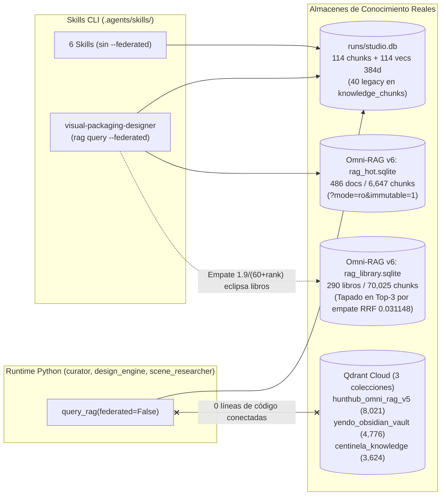

# CHECKPOINT INTEGRAL `v3.5.2` — Fotografía Verificada de Arquitectura, Entorno, Agentes, Código Limpio, Delta SOTA y Healthcheck

- **Fecha / Hora de captura:** `2026-11-24 12:22 ART (UTC-3)`
- **Commit auditado (`HEAD`):** `c7831cc` (`v3.5.2`, rama `main` sincronizada `1:1` con `origin/main`)
- **Modo de ejecución:** Solo lectura estricta sobre código, `.venv`, `runs/studio.db` y colecciones externas. Único artefacto generado: `docs/CHECKPOINT_v352.md`.
- **Política anti-duplicación:** Este documento **no repite** vulnerabilidades/bugs ya documentados en `docs/08_audit_transversal_v352_y_plan_evolucion.md` (`V1–V6`, `A1–A8`) ni repositorios/herramientas ya evaluados en `docs/07_integral_audit_benchmark_and_rag_upgrade_v351.md` y `docs/08` (`HyperFrames`, `pycaps`, `sherpa-onnx`, `BiRefNet-V2`, `sharkyclips`, `openshorts`, `ClipKaro`, `supoclip`, `ViralMint`, `MatAnyone 2`, `bria-rmbg`, `BS-RoFormer`, `RapidOCR`, `FlashRank`, `FastMCP`).

---

## SECCIÓN 1 — Estado Git, Uso de Disco y Árbol Real (`[RUNTIME REAL]`)

### 1.1 Estado Git (`[RUNTIME REAL]`)
- **`git rev-parse --short HEAD`:** `c7831cc`
- **Remoto (`git remote -v`):** `origin -> https://github.com/thunderalbatros/clipping-studio.git`
- **Commits locales adelantados (`git log origin/main..HEAD --oneline`):** `0` *(salida vacía: `main` local coincide exactamente con `origin/main` en `c7831cc`)*.
- **Últimos 5 commits en `main`:**
  1. `c7831cc` — `fix(v3.5.2): P0 hardening + pydantic-ai-slim llm_router migration, RAM streaming, Safe Box, Kick sniper, and ty=0`
  2. `383e694` — `docs(rag): ingest 2025-2026 platform algorithms, virality science, and integral audit v3.5.1`
  3. `f46845b` — `chore(v3.5.1): persist CTO rules and enforce viral floor in scene_researcher`
  4. `3f916c2` — `feat(v3.5): alpha motion-graphics overlays, PySceneDetect cut-guard, word-index grounding, scene-match intelligence, creators profiler, and CI gate`
  5. `bb730b3` — `feat(v3.4.1): real bounties hard filter + geo priority, HITL 5-net kit, vector RAG anti-noise, deno, and 10 real outliers`
- **`git status --short` (al cierre de este checkpoint):**
  - `?? docs/08_audit_transversal_v352_y_plan_evolucion.md` *(reporte previo de sesión)*
  - `?? docs/CHECKPOINT_v352.md` *(este checkpoint)*
  - `0` archivos trackeados modificados.

### 1.2 Uso de Disco Real (`[RUNTIME REAL]`)

| Ruta / Volumen | Tamaño Actual | Desglose Verificado |
| :--- | :---: | :--- |
| **Unidad `C:\`** | **`28.00 GB` libres** / `222.91 GB` totales | `194.91 GB` ocupados (**`87.44%`** de uso) |
| **`.venv/`** | **`781.51 MB`** | Python `3.12.10` + ONNX Runtime + OpenCV + FastEmbed + Rembg + Pydantic-AI Slim |
| **`runs/`** | **`713.62 MB`** *(cuota: `4,096 MB`)* | `twitch_gta6_e2e_02` (`275.91 MB`), `twitch_jynxzi_v2_01` (`149.31 MB`), `twitch_gta6_e2e_01` (`123.99 MB`), `kick_xqc_v2_01` (`96.28 MB`), `test_gta6_01` (`48.78 MB`), `test_compile_16_9` (`9.23 MB`), `branding` (`8.00 MB`), `studio.db` (`~2.12 MB`) |
| **`_references/`** | **`543.65 MB`** | `openshorts` (`173.32 MB`), `opensource-clipping` (`151.66 MB`), `sharkyclips` (`62.10 MB`), `ClipKaro` (`59.33 MB`), `clipmint` (`44.31 MB`), `cutawan` (`26.69 MB`), `x-algorithm` (`24.28 MB`), `agentic-video-editor` (`1.96 MB`). *(`supoclip` y `ViralMint` ya purgados por KS-4).* |
| **`models/`** | **`297.48 MB`** | `rembg/birefnet-general-lite` (`213.63 MB`), `fastembed_cache` (`64.07 MB`), `yamnet` (`15.36 MB`) + `UltraFace`/`LR-ASD` ONNX (`~4.42 MB`) |
| **`src/` + `tests/` + `docs/` + `assets/`** | **`2.88 MB`** | `src/` (`1.31 MB`, `14,833` LOC), `assets/` (`0.86 MB`), `tests/` (`0.42 MB`), `docs/` (`0.29 MB`) |

### 1.3 Árbol Compacto del Proyecto (`[RUNTIME REAL]`)
```text
clipping studio/
├── AGENTS.md · pyproject.toml · requirements.lock · .env · .env.example · .gitignore · .antigravityignore · .gitleaks.toml
├── .github/workflows/ci.yml
├── .agents/
│   ├── hooks.json
│   ├── rules/   [01_security_and_secrets.md, 02_finops_gcp_30usd.md, 03_anti_dmca_and_voice.md, 04_windows_media_runtime.md, 05_sota_and_architecture.md]
│   └── skills/  [av-director/, bounty-and-distribution-ops/, marketing-strategist/, media-engineer/, retention-critic/, viral-intelligence-analyst/, visual-packaging-designer/]
├── src/         (25 archivos · 14,833 LOC)
│   ├── __init__.py (1) · analytics.py (246) · bounties.py (555) · callout.py (920) · captions.py (228)
│   ├── cli.py (817) · compiler.py (288) · curator.py (926) · db.py (941) · design_engine.py (1443)
│   ├── gc.py (205) · live_sniper.py (621) · llm_router.py (430) · miner.py (1127) · notifier.py (120)
│   ├── rag_engine.py (1134) · renderer.py (1372) · resource_guard.py (120) · scene_researcher.py (979)
│   ├── schemas.py (374) · speaker_guard.py (555) · style_analyzer.py (392) · transcriber.py (611)
│   └── trends.py (282) · voice_engine.py (146)
├── evals/       [media_check.py (359)]
├── scripts/     [rtk_pretool_hook.py (228), security_pretool_hook.py (236)]
├── config/      [channel_profile.yaml, profiles.yaml, streamers.yaml]
├── context/     [golden_references.json, gta6_living_brief.md, gta6_lore_index.json, platform_algorithms_index.json, streamer_profiles.json, viral_style_dna.json]
├── assets/      [fonts/{Montserrat-Black.ttf, OFL.txt}, sfx/{bleep_1khz.wav, impact_sub.wav, pop.wav, riser.wav, whoosh.wav, LICENSES.md}]
├── docs/        [01..08_*.md, algorithms_and_virality_bible.md, design_bible.md, engineering_patterns.md, marketing_playbook.md, shortform_and_editing_bible.md, style_bible.md, token_optimization_guide.md, CHECKPOINT_v352.md]
└── tests/       (12 archivos · 66 funciones test_* · 76 casos ejecutados)
```

---

## SECCIÓN 2 — Configuración Exacta del Entorno, Tecnologías y Herramientas (`[RUNTIME REAL]` + `[ESTÁTICO]`)

### 2.1 Versiones Reales Instaladas y Hardware Detectado (`[RUNTIME REAL]`)

| Componente | Versión / Estado Verificado | Notas de Runtime |
| :--- | :--- | :--- |
| **Python (`.venv`)** | `3.12.10` (`MSC v.1943 AMD64`) | Entorno aislado activo |
| **`pydantic` / `pydantic-ai-slim`** | `2.14.4` / `2.71.0` | Paquete monolítico `pydantic-ai`: `AUSENTE` (cumple regla slim) |
| **`google-genai` / `groq` / `openai`** | `2.34.0` / `1.7.0` / `3.57.0` | Clientes Vertex AI, Groq LPU y OpenRouter |
| **`onnxruntime`** | `1.32.0` | Providers: `['AzureExecutionProvider', 'CPUExecutionProvider']` (`DEVICE=CPU`) |
| **`onnx-asr` / `faster-whisper`** | `0.12.0` / **`AUSENTE`** | ASR real corre sobre `onnx-asr` (`parakeet-tdt-0.6b-v3`); `faster-whisper` no está instalado |
| **`auto-editor` / `scenedetect` / `pysubs2`** | `29.3.1` / `0.7.3` / `1.9.1` | Trim de silencios, cut-guard de planos y subtítulos `.ass` |
| **`rembg` / `opencv-python-headless` / `pillow`** | `2.0.87` / `5.1.0.95` / `13.0.0` | Matting `birefnet-general-lite`, visión y composición |
| **`sqlite-vec` / `fastembed`** | `0.1.9` / `0.9.1` | Búsqueda vectorial `float[384]` (`BAAI/bge-small-en-v1.5`) |
| **`yt-dlp` / `curl-cffi` / `deno`** | `2026.10.26` / `0.17.0` / `2.9.8` | Ingesta parcial YouTube EJS + Kick TLS Chrome impersonation |
| **`ffmpeg` / `ffprobe`** | `9.0.2-full_build` (`gcc 16.2.0`) | Con `h264_qsv`, `hevc_qsv`, `h264_nvenc`, `libx264`, `libass`, `libplacebo`, `vulkan`, `whisper` |
| **`node` / `gcloud`** | `v24.21.0` / `Google Cloud SDK 587.0.0` | `core 2026.09.25`, `bq 2.1.39` |
| **Calidad / SecOps (`ruff` / `ty` / `gitleaks`)** | `0.17.6` / `0.0.107` / `8.30.1` | `ty` en `~/.local/bin/ty.EXE`; `gitleaks` en WinGet Packages |
| **Hardware & Aceleración (`local_hp`)** | Windows 10 · `8` cores lógicos (`onnx_threads=4`) | RAM total `16,072 MB` (`3,623–4,946 MB` libres, `69%–77%` uso), `AC power` (`on_battery=False`), `h264_qsv` operativo |

### 2.2 Presencia de Variables en `.env` (`[RUNTIME REAL]` — Cero Valores Expuestos)
- **`PRESENTE` (`29` claves):** `COMPUTE_PROFILE`, `STUDIO_MODE`, `VOICE_MODE`, `USE_VERTEX_AI`, `GCP_PROJECT_ID`, `GCP_LOCATION`, `GOOGLE_APPLICATION_CREDENTIALS`, `GEMINI_MODEL`, `GROQ_API_KEY`, `OPENROUTER_API_KEY`, `GCP_SPOT_ZONE`, `GCP_GCS_BUCKET`, `GCP_BATCH_BUCKET`, `GCP_IDLE_SHUTDOWN_MINUTES`, `LLM_DAILY_BUDGET_USD`, `YT_COOKIES_PATH`, `YOUTUBE_API_KEY`, `KICK_CLIENT_ID`, `KICK_CLIENT_SECRET`, `HF_TOKEN`, `HF_HUB_ENABLE_HF_TRANSFER`, `SERPER_API_KEY`, `FIRECRAWL_API_KEY`, `TELEGRAM_BOT_TOKEN`, `TELEGRAM_CHAT_ID`, `QDRANT_HOST`, `QDRANT_API_KEY`, `QDRANT_COLLECTION_OBSIDIAN`, `QDRANT_COLLECTION_CLIPPING_V2` *(nota: colección inexistente en Qdrant Cloud)*.
- **`AUSENTE` (`4` claves):** `GEMINI_API_KEY` *(usa Vertex AI ADC)*, `TWITCH_CLIENT_ID`, `TWITCH_CLIENT_SECRET` *(Twitch opera vía GraphQL público / `TwitchDownloaderCLI`)*, `WHOP_API_KEY` *(escaneo opera vía Serper/Firecrawl)*.

### 2.3 Matriz de Tecnologías por Capa del Pipeline (`[ESTÁTICO]` + `[RUNTIME REAL]`)

| Capa del Pipeline | Herramienta / Módulo Actual | Ejecución Hoy | Estado de Cableado | Gobernado por `config/*.yaml` |
| :--- | :--- | :---: | :---: | :--- |
| **Radar & Bounties CPM** | `Serper` + `Firecrawl` + `YouTube Data API v3` (`bounties.py`, `trends.py`) | Cloud API desde `local_hp` | **Activo** (`cli bounties`, `cli trends`) | `config/streamers.yaml` (parcial en `trends.py`) |
| **Ingesta VOD Quirúrgica** | `yt-dlp` (`--download-sections` + `deno`) + `curl_cffi` + `TwitchDownloaderCLI` (`miner.py`) | `local_hp` (CPU/Red) | **Activo** (`cli mine`, `cli run`) | `config/streamers.yaml` + `studio.db#creators` + `channel_profile.yaml` (`storage.runs_max_gb`) |
| **Captura en Vivo** | `HLSRingBuffer` 90s + Twitch IRC WS + Kick REST (`live_sniper.py`) | `local_hp` (Asyncio) | **Activo** (`cli sniper`) | Independiente (flags CLI) |
| **ASR + Gate Anti-DMCA** | `parakeet-tdt-0.6b-v3` (`onnx-asr` int8) + `YAMNet` ONNX (`transcriber.py`) | `local_hp` (CPU ONNX) | **Activo** (`cli transcribe`, `cli run`) | Hardcoded en `transcriber.py` (`profiles.yaml` **no se lee**) |
| **Detección Facial & ASD** | `UltraFace` + `LR-ASD` ONNX (`speaker_guard.py`) | `local_hp` (CPU ONNX) | **Activo** (invocado por `curator`/`renderer`/`design_engine`) | `channel_profile.yaml` (`skip_npc_dialogue`, `max_webcam_upscale`, `webcam_exclusion_pad_px`) |
| **Inteligencia Scene-Match** | `yt-dlp ytsearch` + Kick clips + FFmpeg `/steal` + Gemini VLM (`scene_researcher.py`, `style_analyzer.py`) | `local_hp` + Cloud LLM | **Activo** (`cli research`, `curator.py`) | Umbrales en `scene_researcher.py` |
| **Curación & Crítico LLM** | `pydantic-ai-slim` -> Vertex Gemini (`3.8-flash`) -> Groq -> OpenRouter (`llm_router.py`, `curator.py`) | Cloud API | **Activo** *(BlindCritic solo pre-render)* | `.env` (`GEMINI_MODEL`, `LLM_DAILY_BUDGET_USD`); `profiles.yaml` **ignorado** |
| **RAG Híbrido + Federado** | `SQLite FTS5` + `sqlite-vec` + `fastembed` (`studio.db`) + `Omni-RAG v6` SQLite RO (`rag_engine.py`) | `local_hp` (CPU ONNX) | **Parcial** (`federated=False` en todo `src/`; `Qdrant Cloud` **huérfano**) | Variables env / constantes en `rag_engine.py` |
| **Edición, Callout & Render 9:16** | `auto-editor` + `PySceneDetect` + Chrome CDP Alpha `.mov` + `pysubs2`/FFmpeg `libass` + `h264_qsv` (`renderer.py`, `callout.py`, `captions.py`) | `local_hp` (Intel UHD QSV + CPU) | **Activo** (`cli render`, `cli run`) | `channel_profile.yaml` (parcial: lee `cut_silence_over_sec`, `captions.pos_x/pos_y`, ignora `safe_zones`/`highpass_hz`) |
| **Portadas 9:16 & Thumbnails 16:9** | `rembg` (`birefnet-general-lite`) + Chrome Headless HTML/CSS + APCA + FFT Saliency (`design_engine.py`) | `local_hp` (CPU ONNX + Chrome) | **Activo** (`cli cover`, `cli thumbnail`, `cli run`) | Constantes geométricas en `design_engine.py` |
| **Compilador Long-Form 16:9** | FFmpeg `libx264` + capítulos YouTube (`compiler.py`) | `local_hp` (CPU) | **Parcial** (`cli compile`, hoy pillarboxea `9:16`) | Flags CLI |
| **Voz / TTS Editorial** | `kokoro-onnx` wrapper (`voice_engine.py`) | `local_hp` | **Huérfano** (`0` imports en `src/`; `kokoro` no instalado) | `channel_profile.yaml` (`voice.mode: none`) |
| **Alertas HITL Telegram** | Bot API HTML (`notifier.py`) | Cloud API | **Parcial** (cableado en `live_sniper.py`; **no** en `cli run`/`bounties`) | `.env` (`TELEGRAM_BOT_TOKEN`, `TELEGRAM_CHAT_ID`) |
| **Perfiles Multi-Carril Cloud** | Declaración `gcp_spot_l4` / `colab_t4` (`config/profiles.yaml`) | N/A | **Huérfano / Decorativo** (`0` lecturas en `src/`) | `config/profiles.yaml` |

---

## SECCIÓN 3 — Inventario del Equipo de Agentes, Rules, Skills, Hooks y MCPs (`[ESTÁTICO]` + `[RUNTIME REAL]`)

### 3.1 Constitución y Reglas Always-On (`.agents/rules/` — Total `5,953 B`)
1. `01_security_and_secrets.md` (`1,008 B`, `11` líneas): Cero exposición de `.env`/cookies/keys, exclusión `.gitignore`/`.antigravityignore`, auditoría manual de skills, filtro comercial **KS-4** (`MIT`/`Apache-2.0`/`Unlicense`, prohibido `CC-BY-NC`) y solo lectura externa (`?mode=ro&immutable=1`).
2. `02_finops_gcp_30usd.md` (`851 B`, `11` líneas): Tope `USD 30`, watchdog `10–15m`, cero VODs completos en GCP, Prompt Cache, RAG `<=550 tok` y restricción `sm_75` (`float16`/`int8` + `sdpa`).
3. `03_anti_dmca_and_voice.md` (`1,269 B`, `14` líneas): 3 modos `--audio-policy` (`strict_clean`, `sound_campaign`, `keep_original`), bleep/censura `0–7.5s`, `VOICE_MODE=none` en Bounties, cuentas limpias y Gate HITL obligatorio.
4. `04_windows_media_runtime.md` (`938 B`, `10` líneas): `yt-dlp` con `--cookies <txt>` + `deno` + `--impersonate chrome`, `ass=subs.ass:fontsdir=fonts` relativo + `format=nv12` en `h264_qsv`, prohibido `-c copy` inicial, validación `ffprobe` + `PIL.Image.size`.
5. `05_sota_and_architecture.md` (`1,887 B`, `16` líneas): Ventana SOTA 3m KS-4, 3 carriles de cómputo, fluidez visual (cero Frame 0 contaminado, cero freeze-frames antifuncionales), *Research-First / Scene-Match*, apertura multi-cliente sin whitelists bloqueantes e higiene de disco (`cli gc`).

### 3.2 Las 7 Skills Especializadas (`.agents/skills/`)

| # | Skill | Rol y Disparadores | Herramientas / Módulos que Invoca | Indexada en `rag_engine.py` | Consulta RAG Instruida |
| :-: | :--- | :--- | :--- | :---: | :--- |
| 1 | `bounty-and-distribution-ops` | Gate de campañas CPM (burn `20–80%`, geo-lock, ToS), envíos HITL y telemetría 24h/72h | `src/bounties.py`, `src/analytics.py`, `cli rag query` | ✅ Sí (`bounties_dmca`) | `--domain bounties_dmca` (`federated=False`) |
| 2 | `viral-intelligence-analyst` | Radar `/outliers` (`vph`) + disección FFmpeg `/steal` -> `viral_style_dna.json` | `src/trends.py`, `src/style_analyzer.py`, `yt-dlp`, `FFmpeg` | ❌ **No** | Ninguna |
| 3 | `media-engineer` | Ingesta parcial, ONNX stack, `resource_guard`, `auto-editor`, `FFmpeg`/`libass`, `DesignEngine`, RAG | `miner.py`, `transcriber.py`, `speaker_guard.py`, `renderer.py`, `rag_engine.py`, `context7` | ✅ Sí (`media_engineering`) | Documenta puente `?mode=ro&immutable=1` |
| 4 | `av-director` | Diseño narrativo (*Rule of Six*, *Synchresis* `0.25s`, *Seamless Loop*, `EditPlan` `webcam_position: top`) | `src/curator.py`, `src/renderer.py`, `cli rag query` | ❌ **No** | `cli rag query "<tema>"` (`federated=False`) |
| 5 | `marketing-strategist` | Hooks `0–3s` (Kallaway/CCN), packaging nativo 5 redes (X `+20`, IG `10-en-30d`, YT *Engaged Views*), puente YPP | `src/curator.py`, `src/analytics.py`, `src/compiler.py` | ❌ **No** | Solo lectura directa de `.md`/`.json` |
| 6 | `visual-packaging-designer` | Covers `9:16` Método C 2 capas, thumbnails `16:9` `BiRefNet-lite` *Text-Behind-Subject*, APCA `>=75`, FFT Saliency | `src/design_engine.py`, Chrome Headless, `PIL`, `cli rag query --federated` | ✅ Sí (`design_ctr`) | `--federated` (única skill que activa `Omni-RAG v6`) |
| 7 | `retention-critic` | Veto duro (`overall >= 0.75`, `max_retries=1`), safe-zones 5 redes, `-14 LUFS`, Squint `160px`, `seam-gate` | `ffmpeg-mcp-lite`, `evals/media_check.py`, `cli rag query` | ❌ **No** | `--domain design_ctr` y `episodic_memory` (`federated=False`) |

### 3.3 Hooks Activos (`.agents/hooks.json`) y Servidores MCP (`[ESTÁTICO]` + `[RUNTIME REAL]`)
- **Hooks `PreToolUse` activos (`timeout: 5s` c/u):**
  1. `workspace-security-guard` (`matcher: "write_file|edit_file|read_file|run_command"` -> `scripts/security_pretool_hook.py`): bloquea lecturas/dumps de `.env`/`*cookies*.txt`/credenciales y cualquier escritura o comando mutante hacia rutas externas (`~/.gemini/config`, `web-software-factory`, `centinela-studio`, `streamerbot`, `yendo_mobile` o fuera del workspace).
  2. `rtk-shell-compressor` (`matcher: "run_command"` -> `scripts/rtk_pretool_hook.py`): reescribe comandos compatibles (`git`, `pytest`, `ruff`) a través de `rtk` para ahorro de tokens en IDE.
- **Servidores MCP activos (`3` servidores, `12` tools totales — cumple tope `<= 4` MCPs):**
  - En `~/.gemini/config/mcp_config.json` (metadatos leídos sin exponer secretos; `env_keys: {}` vacío en ambos):
    1. **`context7`** (`disabled: false`, `cmd.exe`, `2` lazy tools: `resolve-library-id`, `query-docs`).
    2. **`ffmpeg-mcp-lite`** (`disabled: false`, `uvx`, `8` lazy tools: `ffmpeg_get_info`, `ffmpeg_convert`, `ffmpeg_compress`, `ffmpeg_trim`, `ffmpeg_extract_audio`, `ffmpeg_merge`, `ffmpeg_extract_frames`, `ffmpeg_add_subtitles`).
  - Integrado por plugin IDE activo:
    3. **`gemini-api_gemini-api-docs`** (`2` eager tools: `gemini_search_docs`, `gemini_get_doc`).

### 3.4 Topología Real de Consulta de Conocimiento Hoy



---

## SECCIÓN 4 — Revisión de Código Limpio: Solo Delta Estructural (`[ESTÁTICO]`)

*(Excluye estrictamente `V1–V6` y `A1–A8` ya reportados en `docs/08_audit_transversal_v352_y_plan_evolucion.md`).*

### 4.1 Configuraciones, Módulos y Assets Muertos o Desincronizados
1. **`config/profiles.yaml` es 100% código declarativo muerto (`0` lecturas en `src/`):** Ningún archivo Python carga `config/profiles.yaml`. Sus `32` claves (`local_hp`, `gcp_spot_l4`, `colab_t4`, `asr_fallback: faster-whisper`, `idle_shutdown_minutes`, `video_encoder`, `llm_fallback_ladder`) no gobiernan el runtime.
2. **`23` claves de `config/channel_profile.yaml` jamás se leen en `src/`:** Aunque `src/miner.py` carga el archivo, los identificadores `target_market`, `studio_mode`, `monetization_goal`, `cold_open_max_words`, `cold_open_max_sec`, `ducking_db`, `min_duration_sec`, `min_self_contained_score`, `min_reviewer_score`, `max_review_retries`, `dmca_strict_reject`, `preserve_source_fps`, `webcam_band_ratio`, `webcam_position`, `safe_zones.*` (`top_pct`, `right_pct`, `bottom_pct`, `left_pct`), `font_file`, `outline_color`, `target_lufs` y `highpass_hz` (`70` Hz en YAML vs `80` Hz hardcoded en `renderer.py`) no aparecen en ningún módulo de `src/`.
3. **Divergencia triple de roster (`9` vs `20` creadores):** `config/streamers.yaml` (`9` entradas) y `context/streamer_profiles.json` (`9` entradas) están desfasados respecto a `runs/studio.db#creators` (`20` filas). Los **`11` creadores EN agregados a SQLite** (`adinross`, `agent00`, `darkviperau`, `fanum`, `lordkebun`, `ludwig`, `moistcr1tikal`, `ohnepixel`, `timthetatman`, `typicalgamer`, `valkyrae`) carecen de ficha de estilo/hook/pacing en `context/streamer_profiles.json` (por lo que `build_curator_rag_context` no recupera perfil para ellos).
4. **Módulo y asset huérfanos + empaquetado incompleto:**
   - `src/voice_engine.py` (`146` LOC) tiene **`0` importadores en `src/`** (solo lo importa `tests/test_longform_voice_analytics.py`).
   - `assets/sfx/bleep_1khz.wav` (`93.8 KB`) tiene **`0` referencias en `src/`** (`renderer.py` sintetiza `sine=frequency=1000` al vuelo; `riser.wav` ya fue señalado en `docs/08`).
   - `evals/media_check.py` vive fuera de `src/` sin declararse en `[tool.setuptools.packages]` en `pyproject.toml`, lo que rompe imports de `evals.media_check` si se instala el paquete como wheel en un contenedor limpio sin `PYTHONPATH=.`.

### 4.2 Rutas Windows / Host Hardcodeadas (Bloqueantes para Contenedor Linux en Cloud Run Jobs)
1. **Binarios `.venv\Scripts\*.exe` sin prioridad POSIX (`bin/` / `shutil.which`):**
   - `src/scene_researcher.py:354, 586` y `src/style_analyzer.py:290`: `ytdlp = str(PROJECT_ROOT / ".venv" / "Scripts" / "yt-dlp.exe")` directo (falla con `FileNotFoundError` en Linux aunque `yt-dlp` esté en `/usr/local/bin/yt-dlp` o `.venv/bin/yt-dlp`).
   - `src/miner.py:321, 686` y `src/renderer.py:196`: buscan `.venv/Scripts/yt-dlp.exe`, `TwitchDownloaderCLI.exe` y `auto-editor.exe` antes o en lugar de rutas POSIX `.venv/bin/`.
   - `src/miner.py:47-62`: `_resolve_deno_path()` busca `deno.exe` en `~/.deno/bin/deno.exe` y `LOCALAPPDATA\Microsoft\WinGet` (en Linux el binario es `deno` sin extensión `.exe`).
2. **Fuentes y navegador del sistema Windows:**
   - `evals/media_check.py:189` y `src/callout.py:35`: fallback directo a `C:\Windows\Fonts\seguibl.ttf`.
   - `src/design_engine.py:234-238`: candidatos `C:\Program Files\Google\Chrome\Application\chrome.exe` y `msedge.exe` (en contenedor Linux requiere priorizar `chromium` / `google-chrome-stable` + `--no-sandbox --disable-dev-shm-usage`).
3. **Acoplamiento a ruta local del autor y hooks IDE Windows:**
   - `src/rag_engine.py:33`: `DEFAULT_OMNI_RAG_DIR` apunta por defecto a `r"C:\Users\tomas\Desktop\web-software-factory\.cache"`.
   - `.agents/hooks.json:10, 25` y `scripts/rtk_pretool_hook.py:156-158`: invocan explícitamente `..\.venv\Scripts\python.exe` y `pytest.exe`.

### 4.3 Complejidad Monolítica (`> 200` LOC) y Duplicación Inter-Módulo
- **Funciones críticas `> 200` líneas (`3` monolitos que concentran riesgo de regresión):**
  1. `src/renderer.py:1001-1372` — `render_master_clip()`: **`372` líneas** (mezcla auto-editor, detección ASD, máscaras Pillow, filtro adaptativo FFmpeg, callout CDP, 2-pass loudnorm, bleeping y extracción de covers).
  2. `src/design_engine.py:1147-1443` — `render_editorial_thumbnail_16_9()`: **`297` líneas** (selección de frame, segmentación `BiRefNet`, HTML/CSS inline, Chrome Headless, APCA, Squint y Saliency en una sola función).
  3. `src/callout.py:96-315` — `_build_motion_overlay_html()`: **`220` líneas** de template HTML/CSS/JS embebido en string Python.
- **Sub-monolitos `150–199` líneas (`8` funciones):** `curator.py:curate_pass2_slice` (`197`), `design_engine.py:render_editorial_cover_9_16` (`192`), `cli.py:main` (`184`), `speaker_guard.py:score_streamer_speech_asd` (`160`), `renderer.py:detect_segments_auto_editor` (`160`), `rag_engine.py:_collect_episodic_and_bounty_chunks` (`157`), `renderer.py:_build_adaptive_filter` (`156`) y `db.py:init_db` (`153`).
- **Código duplicado entre módulos:**
  - `_dir_size_bytes()` implementada dos veces en `src/gc.py:76` y `src/miner.py:111`.
  - `_parse_iso_duration_sec()` implementada dos veces en `src/scene_researcher.py:189` y `src/trends.py:23`.
  - Descubrimiento de Chrome/Edge Headless y binarios CLI (`yt-dlp`, `ffprobe`) repetido con variantes divergentes entre `design_engine.py`, `callout.py`, `miner.py`, `scene_researcher.py` y `style_analyzer.py`.

### 4.4 Cobertura Real de Tests por Módulo (`12` archivos · `66` `def test_*` · `76` ejecuciones)
- **Módulos críticos con `0` tests (`tests=[]`):**
  1. **`src/speaker_guard.py` (`555` LOC):** `0` tests (motor `UltraFace` + `LR-ASD` que decide quién habla y dónde cortar la webcam).
  2. **`src/trends.py` (`282` LOC):** `0` tests (ingesta de tendencias YouTube/Kick/Serper y actualización de `gta6_living_brief.md`).
  3. **`evals/media_check.py` (`359` LOC):** `0` tests (gate técnico de salida `ffprobe` / `LUFS` / freeze / safe-zones).
- **Módulos grandes con cobertura solo tangencial (sin archivo `test_<modulo>.py` dedicado):** `src/miner.py` (`1,127` LOC), `src/transcriber.py` (`611` LOC), `src/bounties.py` (`555` LOC), `src/gc.py` (`205` LOC), `src/notifier.py` (`120` LOC) y `src/resource_guard.py` (`120` LOC).

---

## SECCIÓN 5 — Exploración Web Delta (Mayo–Noviembre 2026: Solo Novedades KS-4 No Cubiertas en `docs/07` ni `docs/08`)

Búsqueda acotada a lanzamientos/hitos verificados de los últimos 6 meses (**Mayo–Noviembre 2026**), filtrando código **y** pesos bajo licencia comercial **KS-4 (`MIT` / `Apache-2.0` / `BSD` / `CC0`)** y orientada a **Cloud Run Jobs NVIDIA L4 (Linux batch serverless) + HP 250 G8 (plano de control)**:

| Eje | Proyecto / Modelo / Plataforma | Release Verificado | Licencia Verificada (Código + Pesos) | Qué Reemplaza o Resuelve Exactamente | Veredicto |
| :--- | :--- | :---: | :--- | :--- | :---: |
| **1. Video Matting Temporal** | **`FudanCVL/SAM2Matting`** *(ECCV 2026)* | Jul–Oct 2026 | ❌ **`CC-BY-NC-SA-4.0`** *(pesos no comerciales)* | Matting temporal sobre SAM 2.1/SAM 3. Bloqueado por Regla 01 KS-4 igual que `MatAnyone 2`. | **DESCARTAR (KS-4)** |
| **1. Video Matting Temporal** | **`facebookresearch/sam3` & `sam3.1`** | 2026 | ⚠️ **Custom Meta SAM License** *(gated, no MIT/Apache)* | Tracking/segmentación de video por texto/caja. Licencia propietaria a medida fuera de whitelist KS-4 estricta. | **DESCARTAR EN CORE** |
| **1. Video Matting Temporal** | **`PramaLLC/BEN2` + Estabilización Temporal Optical-Flow/EMA en L4** *(Nota: en May–Nov 2026 no salió ningún modelo de video matting temporal puro con pesos MIT/Apache)* | Activo 2026 | ✅ **`MIT`** *(código + pesos `.onnx`/`.pth` en HF)* | Alternativa comercial limpia a `birefnet-general-lite` para cabello/auriculares; para video en Cloud Run L4 debe combinarse con suavizado temporal `dis_optical_flow` + EMA alpha. | **EVALUAR POST-10 CLIPS** |
| **2. Emoción Multimodal (`EN + ES`)** | **`Qwen3.5-Omni` (`Alibaba / Qwen`)** | 2026 | ✅ **`Apache-2.0`** *(código + pesos)* | Reemplaza `hsemotion-onnx` + heurísticas de texto en lotes Cloud Run L4: entiende simultáneamente **audio + video + prosodia emocional en inglés y español** en una sola pasada GPU. | **ADOPTAR EN FASE 2 (L4)** |
| **2. Emoción Multimodal (`EN + ES`)** | **`SenseVoiceSmall` (`FunAudioLLM`) + `emotion2vec`** | Ecosistema ONNX 2026 | ✅ **`MIT`** *(FunASR/emotion2vec; verificar model card de checkpoint específico)* | Alternativa ligera CPU/L4 a `YAMNet` para tagging acústico-emocional (`<\|HAPPY\|>`, `<\|ANGRY\|>`, risas/aplausos) multilingüe (`EN + ES`) en 1 pasada no-autoregresiva. *(Nota: `Voxtral TTS` descartado por ser `CC-BY-NC-4.0`, mientras `Voxtral Mini Transcribe 2` sí es `Apache-2.0`).* | **EVALUAR POST-10 CLIPS** |
| **3. Compositing GPU / Audio Mixing** | **`storytold/filmcraft` (`v0.20.1`)** | `2026-11-12` | ✅ **`MIT OR Apache-2.0`** | Motor NLE y compositor GPU lineal en Rust puro (`wgpu`) con tiempo entero sin drift y arquitectura de comandos pensada para agentes IA. Aún en `v0.20.x` (no reemplaza hoy la madurez de FFmpeg `9.0.2` + `libplacebo`). | **EVALUAR POST-10 CLIPS** |
| **3. Compositing GPU / Audio Mixing** | **`FFmpeg 9.0.2` ("Lei") con `libplacebo` / `Vulkan` + `pyloudnorm`** *(y descarte de `Matchering`)* | Ago–Oct 2026 *(ya instalado en host)* | ✅ **`pyloudnorm`: `MIT`** · `FFmpeg`: binario CLI externo *(❌ `Matchering` es `GPL-3.0`)* | `pyloudnorm` mide ITU-R BS.1770-4 exacto en Python sobre el array PCM post-jumpcut en `<30 ms` eliminando una pasada completa de subprocess FFmpeg `loudnorm` Pass-1; `Matchering` se descarta por `GPL-3.0`. | **ADOPTAR EN FASE 2** |
| **4. Agentes / RAG / GCP Serverless** | **`EmbeddingGemma 2` (`740M`, Google DeepMind)** | `2026-10-06` | ✅ **`Apache-2.0`** *(código + pesos)* | Reemplaza `BAAI/bge-small-en-v1.5` (solo texto inglés `384d`) por un **único espacio vectorial multimodal `768d` con MRL (`256d/384d/768d`)** que indexa **texto `EN+ES` + frames + clips de video + audio** para buscar escenas virales directo por similitud visual/acústica. | **ADOPTAR EN FASE 2** |
| **4. Agentes / RAG / GCP Serverless** | **`Cloud Run Jobs` con `NVIDIA L4` (`--no-gpu-zonal-redundancy` + GCS FUSE)** | GA / Driver `580.x` 2026 | ✅ Serverless gestionado GCP | **Reemplaza las VMs `g2-standard-4` Spot de Carril 3:** ejecuta lotes de 5–10 clips en contenedor Linux (`4 vCPU`, `16 GiB RAM`, `1x L4`), cobra **por segundo real** y escala a **`$0` exacto al terminar el job** (cero riesgo de VM encendida olvidada ni discos `pd-balanced` huérfanos). | **ADOPTAR EN FASE 2** |
| **4. Agentes / RAG / GCP Serverless** | **`pydantic-evals` + `pydantic-graph` + `sqlite-vec 0.1.9` metadata columns** | 2026 *(`sqlite-vec 0.1.9` ya en `.venv`)* | ✅ **`MIT` / `Apache-2.0`** | `pydantic-evals` reemplaza scripts ad-hoc para evaluar regresión de prompts del `curator`/`RetentionCritic`; `sqlite-vec 0.1.9` corrige `DELETE` sobre columnas metadata texto en `vec0`, habilitando filtrado nativo `domain` pre-KNN ya mismo sin nuevas dependencias. | **ADOPTAR EN FASE 2** |

---

## SECCIÓN 6 — Healthcheck Final Completo (`[ESTÁTICO]` + `[RUNTIME REAL]`)

### 6.1 Verificaciones Estáticas (`[ESTÁTICO]`)

| Comando Ejecutado | Exit Code | Resumen Exacto de Salida |
| :--- | :---: | :--- |
| `ruff check src/ evals/ tests/ scripts/` | **`0`** | `All checks passed!` (`0` errores / `0` warnings) |
| `ty check src/` *(`C:\Users\tomas\.local\bin\ty.EXE` v0.0.107)* | **`0`** | `All checks passed!` (`0` diagnósticos de tipos) |
| `pytest tests/ -q` | **`0`** | `76 passed in 18.25s` (`0` fallos, `0` skips) |
| `gitleaks detect --source . --no-banner --redact` *(v8.30.1)* | **`0`** | `13 commits scanned` (`~1.23 MB` en `1.63s`) -> **`no leaks found`** |

### 6.2 Diagnóstico Vivo `python -m src.cli doctor` (`[RUNTIME REAL]`)
- **Exit code:** **`0`**
- **Resumen JSON devuelto:**
  - `hardware`: `platform="windows"`, `logical_cores=8`, `free_ram_mb=3623`, `total_ram_mb=16072`, `used_ram_pct=77`, `free_disk_gb=28.0`, `total_disk_gb=222.91`, `on_battery=false`, `onnx_threads=4`.
  - `heavy_local_allowed`: `{"allowed": true, "reason": "resources healthy"}`.
  - `storage`: `runs_mb=713.58` / `quota_mb=4096.0`.
  - `llm_budget_utc_day`: `spent_usd=0.013557` / `cap_usd=2.5`.
  - `onnxruntime_version`: `"1.32.0"`.
  - `rag`: `local_chunks=114`, `local_vec_chunks=114`, `sqlite_vec_loaded=true`, `federated_omni_rag_hot=true`, `federated_omni_rag_library=true`.
  - `binaries`: `ffmpeg=true`, `ffprobe=true`, `deno=true`, `yt-dlp=true`, `TwitchDownloaderCLI=true`, `auto-editor=true`, `rtk=true`, `headless_browser="chrome.exe"`.
  - `assets`: `montserrat_ttf=true`, `montserrat_ofl=true`, `sfx_count=5`, `ultraface_onnx=true`, `lr_asd_frontend=true`, `lr_asd_backend=true`, `yamnet_onnx=true`, `birefnet_general_lite_onnx=true`, `rtk_hooks_json=true`.

### 6.3 Conteo Exacto de Filas en `runs/studio.db` (`[RUNTIME REAL]`, SQLite `?mode=ro`)

| Tabla / Vista Solicitada | Nombre Real en `studio.db` | Filas Exactas | Observación Verificada |
| :--- | :--- | :---: | :--- |
| `runs` *(corridas / VODs)* | `vods` | **`2`** | La tabla maestra de corridas se denomina `vods` en `src/db.py` |
| `slices` | `slices` | **`6`** | `transcripts_fts` sincronizada = `6` filas |
| `clips` | `clips` | **`1`** | Clip renderizado y validado en `runs/twitch_jynxzi_v2_01` |
| `creators` | `creators` | **`20`** | `9` seed de `streamers.yaml` + `11` creadores EN adicionales |
| `campaigns` | `campaigns` | **`5`** | Campañas iniciales importadas |
| `publish_metrics` | `telemetry` (`event_type='publish_metrics'`) | **`0`** *(de **`71`** en `telemetry`)* | No existe tabla `publish_metrics` separada; vive como evento en `telemetry` (`0` publicados aún) |
| `scene_blueprints` | `scene_blueprints` | **`1`** | Caché Scene-Match (`gta6`) |
| `rag_chunks` | `rag_chunks` | **`114`** | `shortform_craft=46`, `gta6_streamers=20`, `bounties_dmca=17`, `media_engineering=16`, `design_ctr=10`, `episodic_memory=5` |
| `rag_chunks_vec` | `rag_chunks_vec` | **`114`** | Paridad exacta `1:1` (`sqlite_vec` cargado OK, `0` huérfanos) |
| `knowledge_chunks` | `knowledge_chunks` *(legacy)* | **`40`** | Tabla FTS5 antigua sin consumidores en `src/` (`knowledge_chunks_fts=40`) |
